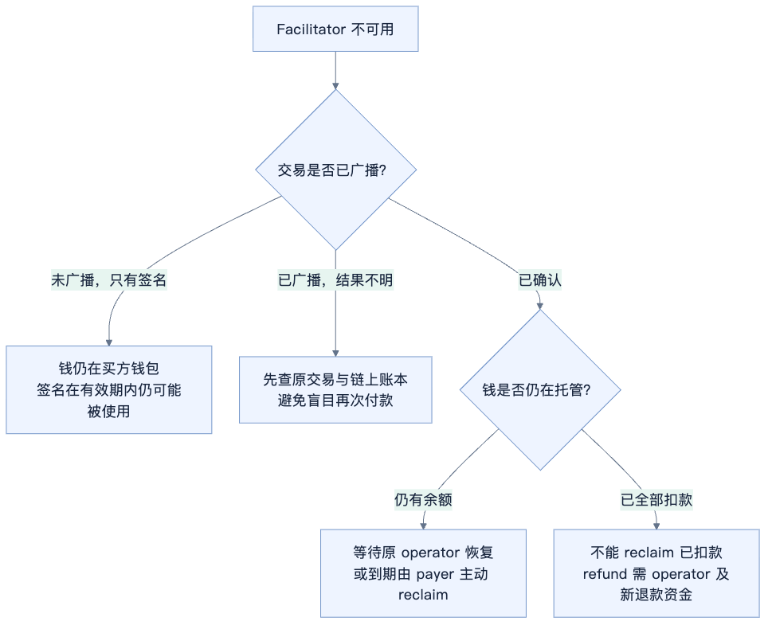

# x402 auth-capture 支付机制与合约分享

> 状态：未经评审的研究草稿。内容及移植判断尚未完成独立评审。

更新日期：2026 年 10 月 19 日。

auth-capture 的核心是把“资金到位”和“最终付给商家”分开。买方先签一份有金额上限、有效期限和固定收款人的支付条款；authorize 上链后钱进入托管；operator 随业务进展执行 capture，或用 void 释放未扣款。到期后买方可以自行 reclaim 剩余托管款。已扣款的 refund 则需要重新提供资金。

它适合有明确预算和期限的订单、异步任务与会话结算。它不是无限期自动扣费，也不自带交付验收、强制退款或自动故障处理。

本文以合约为重点，先建立角色和资金关系，再说明 x402 接口如何驱动合约。逐函数、逐文件的固定行号入口见[官方代码走读](auth-capture-official-code-walkthrough.md)。

源码基准：x402-foundation/x402 提交 faa1c694c66a3732aaabbce93bdae140e521a67d（2026 年 10 月 15 日 UTC）；base/commerce-payments 提交 b748fdd7a830a655a19a530edcf2a94b9dc7d25f（2026 年 9 月 3 日 UTC），以 v1.1 费用接口为主。源码能力不等于已发布 SDK 或接入产品开放的全部能力。金额示例为推演；本文未执行合约测试或链上交易，TRON 部分为移植分析。

## 1 什么场景需要先托管再扣款

例如 Agent 委托服务生成报告，预算上限 10 USDC。一开始无法确定最终费用，服务方也不愿意无资金保证就开工。双方约定先托管 10，任务完成后扣实际费用 6，再释放剩余 4。

| 场景 | 为什么需要 auth-capture | 边界 |
| --- | --- | --- |
| 异步生成、外包任务 | 先确保预算到位，交付后结算 | 是否交付由业务或 operator 规则判断 |
| 按实际用量计费 | 先锁上限，完成后扣实际金额 | 需要评估相比 upto 增加托管的价值 |
| 一个会话分阶段扣款 | 一次收款后可以多次 capture | 每次通常单独上链；累计不超托管款 |
| 订单等待确认或取消 | 等待库存、交付等条件后扣款或释放 | 扣款必须在期限前完成 |

“持续一段时间”不等于订阅。相同支付身份只能收款一次，不能反复充值；额度用完或扣款期限到达，需要新的付款授权。逐月自动续费还需要额外的周期授权及业务设计。托管款在此期间已离开买方可用余额。

## 2 商家 operator 与 facilitator 的关系

| 名称 | 白话职责 | 合约或协议字段 |
| --- | --- | --- |
| 买方 | 出钱，到期可取回剩余托管款 | payer |
| 商家收款地址 | 接收扣款后的净额 | receiver；HTTP 条件中是 payTo |
| 商家操作授权方 | 同意具体扣款、撤销、退款，或由受认证委托方代签 | receiverAuthorizer |
| Operator | 直接调用 Escrow 的支付操作地址 | operator；HTTP 条件中是 captureAuthorizer |
| Facilitator | 验证、模拟、广播及等待交易结果的服务 | 提供 /supported、/verify、/settle |

默认 delegated 模式下，operator 是 facilitator 控制的提交地址；并非“谁是商家谁就是 operator”。同一地址也可以兼任多个角色。商家通过签名或经过认证的委托请求表达操作意图。

custom 模式下，operator 是自定义合约，facilitator 只 relay 初始收款；后续按 operator 自己的规则和接口执行。policy 类型在本文固定实现中仍属预留，不能当作已可用方案。

基础 Escrow 不验证商家 authorizerSignature，只检查 operator、金额、费用、时间和余额。在 delegated 模式中，商家意图的验证依赖 facilitator；需要链上强制验签或仲裁，必须由相应 operator 合约实现。

## 3 合约之间如何配合


图 1：调用关系与权限关系。TokenStore 并不计算费用；它只保管代币并按 Escrow 指令支出。代币余额实际由 USDC 等 token 合约维护。

| 合约 | 管什么 | 不负责什么 |
| --- | --- | --- |
| AuthCaptureEscrow | 每笔支付身份、余额状态、权限、期限和分账约束 | 不判断 HTTP 业务交付 |
| ERC3009PaymentCollector | 使用 token 的 ReceiveWithAuthorization 收款 | 不决定商户实际用量 |
| Permit2PaymentCollector | 用 Permit2 授权收款 | 不替代首次 token allowance |
| OperatorRefundCollector | 标准退款路径从 operator 收取退款资金 | 不自动向商户追缴原款 |
| TokenStore | 保管同一 operator 的多笔托管资金，只接受 Escrow 支出指令 | 不自行判断订单状态或收费 |

Escrow 和各 Collector 是可供多笔支付使用的合约，不是每笔订单新部署一次。每个 operator 对应自己的 TokenStore，同一条链、同一 Escrow 下复用；各笔支付仍由独立 paymentInfoHash 分账。

### TokenStore 什么时候部署


图 2：部署 Escrow 时先创建 TokenStore 模板。operator 的实例地址通过 CREATE2 提前确定，authorize 可先将代币转入这个尚未部署代码的地址；第一次需要转出时，Escrow 自动部署 clone 并转账。

同一 operator 的多个服务实例共用 TokenStore。一个 facilitator 轮换多个执行地址，则每个 operator 地址各有一个。换链或换 Escrow 要重新计算对应实例。实例部署成本计入触发首次支出的那笔交易。

## 4 一笔支付的条款与账本

PaymentInfo 表示固定条款，PaymentState 表示不断变化的账本。完整条款不作为可修改订单保存在合约里；调用时传回原始条款，合约计算编号后读取状态。

| 账本字段 | 含义 |
| --- | --- |
| hasCollectedPayment | 是否已收过款；全部退完也不会恢复 false |
| capturableAmount | 还在托管里、可扣给商家的金额 |
| refundableAmount | 已扣过且尚允许退的额度；不是另存的退款准备金 |

以下六个函数共同维护这份账本。

| 函数 | 谁直接调用 | 执行后的资金变化 |
| --- | --- | --- |
| authorize | operator | 买方 → TokenStore，建立可扣余额 |
| capture | operator | TokenStore → 商家及费用方，可扣余额减少、可退额度增加 |
| charge | operator | 一笔交易内收款并分账，不留下可扣余额 |
| void | operator | 剩余托管款全部返回买方 |
| reclaim | payer | 扣款到期后，剩余托管款全部返回买方 |
| refund | operator | 收入新的退款资金再付给买方，可退额度减少 |

## 5 x402 的 HTTP 接口和结算流程

业务 API 仍是 GET /weather 这样的普通接口。未付款时返回 HTTP 402，PAYMENT-REQUIRED 头携带 Base64 编码的付款条件。客户端构造签名后，携 PAYMENT-SIGNATURE 重试同一业务请求；服务端调用 facilitator，不需要把合约接口直接暴露给买方。

| Facilitator 接口 | 职责 |
| --- | --- |
| GET /supported | 返回支持的网络、支付方案及相关配置 |
| POST /verify | 检查付款或生命周期数据并模拟；不因此锁定资金 |
| POST /settle | 验证后提交对应链上操作，并处理回执或 pending |

/verify 与 /settle 使用相同的外层数据结构。下例为结构示意，尖括号表示应填入的完整对象：

```text
{
  paymentPayload: {
    x402Version: 2,
    accepted: <客户端选择的付款条件>,
    payload: <付款签名或生命周期操作数据>
  },
  paymentRequirements: <服务端认可的付款条件>
}
```

### 默认 delegated escrow 的两次 settle


图 3：以可 relay 生命周期的 delegated、sync escrow 路径为例。独立 /verify 调用是预检查，不是资金保证；authorize 链上成功才表示托管已到位。图中的确认回执需要结合应用确认策略理解，不能把“已广播”当作“已成功”。

第一次 /settle 携客户端付款授权，facilitator 调 authorize。业务处理完成后，第二次 /settle 携 capture 操作数据，facilitator 调 capture；操作授权可由商家自签，或由 facilitator 在认证调用方后代签。

| 付款或操作条件 | /settle 对应的合约调用 |
| --- | --- |
| collect payload、paymentFlow=escrow | authorize |
| collect payload、paymentFlow=authorization | charge；服务端补齐金额、费用与操作授权 |
| payload.type=capture | capture |
| payload.type=void | void |
| payload.type=refund | refund；还需启用并具备退款出资能力 |

因此官方示例不需要单独的 /capture 或 /refund HTTP 路由，而是复用 /settle。商家侧 AuthCaptureLifecycleManager 提供 capture、voidPayment、refund 方法，用保存的完整支付记录构造请求。

captureMode=sync 时，请求结束阶段发起扣款；deferred 时先完成托管，后续由应用调用生命周期管理器扣款。失败时 hooks 可发起 void，但仍需上链成功才算释放；不是异常一发生就自动退款。

## 6 手续费与实际转账


图 4：托管 10 USDC，本次 capture 6 USDC，费用固定为 1%。商家收到 5.94，费用方收到 0.06，剩余 4 继续托管。

货款与手续费是同一笔 capture 交易里的两次内部 token 转账，不是两笔独立链上交易。任一转账失败，整笔交易回滚。费用为零时只转商户净额。费用不一定给 facilitator，具体地址由条款及执行参数决定；主合约不强制加收另一笔协议费。

链上 gas 是另一种成本，由发交易账户或代付方承担；默认 delegated 模式通常是 facilitator/operator 用原生币支付。USDC 手续费与 ETH gas 不能混为一项。

capture 后释放剩余款则不同：官方 SDK 先完成 capture，再单独尝试 void。第二笔是 best effort，capture 成功不证明 void 已成功。需要结合 void 的交易结果及真实链上余额对账，不能只相信本地记录中的清零意图。[对应代码走读](auth-capture-official-code-walkthrough.md#15-pending-重试和剩余款释放的实际边界)

## 7 三个期限与 facilitator 故障


图 5：三个期限允许相等，但业务应留出执行和确认余量。时间到达 authorizationExpiry 时，capture 已禁止，payer 的 reclaim 开始可用；refund 在 refundExpiry 时起禁止。void 本身没有单独的期限判断。

合约不会定时醒来，也不会感知 facilitator 宕机。任何转账都需要有效调用。

| 故障时的支付阶段 | 链上情况 | 谁能继续处理 |
| --- | --- | --- |
| 只有签名，未提交收款 | 钱仍在买方钱包；签名在有效期内仍可能被使用 | 恢复后查询是否提交，不能靠关闭页面取消授权 |
| 已广播，回执不明 | 交易可能 pending，也可能已成功 | 查原交易、事件与 paymentState，先对账再重试 |
| 已托管，尚未扣完 | 剩余钱仍在 TokenStore | 原 operator 可继续 capture/void；到期 payer 可 reclaim |
| 已全部 capture | 已分发给商户及费用方 | 原 operator 在退款窗口内按退款规则 refund，payer 不能 reclaim 已扣款 |



图 6：到期取回是买方主动操作，需要原始 PaymentInfo、交易入口和 gas 或代付。另一家 facilitator 通常不能直接接管旧支付，因为 operator 已在条款中固定；可以更换服务器，但仍须通过原 operator 身份操作。提前使用支持多个执行者的 operator 合约，才能按该合约规则安排接管。

商家已交付但未在截止前 capture，也可能失去扣款机会，因此交付、扣款期限和故障恢复余量需要一起设计。operator 合约的权限或暂停规则可能进一步影响可用性，需按具体实现判断。

## 8 核心合约代码详解


以下以 Commerce Payments v1.1 对应源码为主。AuthCaptureEscrow 管支付身份、余额账本和规则，Collector 管收款方式，TokenStore 管代币保管。理解某个函数时，要同时看它检查什么、改哪个账本字段、实际代币从哪里转到哪里。

### PaymentInfo 是不可随意更改的支付条款

PaymentInfo 随每次调用传入，合约没有把整份结构体另存为订单记录。它计算整份条款的哈希，再用哈希读取 PaymentState。因此，把 receiver、期限或其他字段改掉，会得到另一笔支付身份，不能继续操作原支付余额。

| 字段 | Solidity 类型 | 对资金和权限的含义 |
| --- | --- | --- |
| operator | address | authorize、charge、capture、void、refund 的直接调用者 |
| payer | address | 付款人及 reclaim 的直接调用者 |
| receiver | address | 扣款后收到净额的地址 |
| token | address | 本笔支付使用的 ERC-20 |
| maxAmount | uint120 | 本笔收款的上限，不是可重复补充的额度 |
| preApprovalExpiry | uint48 | authorize / charge 的截止时间 |
| authorizationExpiry | uint48 | capture 的截止时间，也是 reclaim 的起始时间 |
| refundExpiry | uint48 | refund 的截止时间 |
| minFeeBps / maxFeeBps | uint16 | 每次扣款的费用上下界，100 bps 等于 1% |
| feeReceiver | address | 非零时固定费用接收方；零时允许 operator 在扣款时指定 |
| salt | uint256 | 区分不同支付；协议还可用它承诺商户授权地址等信息 |

字段顺序和类型参与 PAYMENT_INFO_TYPEHASH，不能仅凭字段语义相同就换名、换顺序或换编码。amount、feeAmount 使用代币最小单位；10 USDC 在 6 位小数时是 10000000，不能把浮点数直接传入合约。

### PaymentState 是三个数值含义明确的账本字段

```solidity
struct PaymentState {
    bool hasCollectedPayment;
    uint120 capturableAmount;
    uint120 refundableAmount;
}
```

hasCollectedPayment 表示这笔支付是否已经执行过收款；即使钱全退完，也不恢复为 false。capturableAmount 对应还没分发的托管金额。refundableAmount 对应已扣款、尚可退的额度，背后没有自动保留同额资金。

记 A 为成功收款金额、C 为累计扣款、V 为通过 void 或 reclaim 返还的金额、R 为累计退款。escrow 路径满足：

```text
capturableAmount = A - C - V
refundableAmount = C - R
A <= maxAmount
```

charge 路径直接令 C = A，可扣款余额从一开始就是 0。refund 不会增加 capturableAmount，不能“退款后再用原授权扣回来”。同一 operator 的 TokenStore 保存多笔支付的实际资金，但每笔支付只能按自己的余额执行。

### 公共权限与金额检查

```solidity
modifier onlySender(address sender) {
    if (msg.sender != sender) revert InvalidSender(msg.sender, sender);
    _;
}
```

这里比较的是 Escrow 看到的直接调用者 msg.sender，不是交易最外层的 EOA。若 operator 是合约，必须由该合约调用 Escrow；随便一个 facilitator EOA 直接发交易不会通过。

authorize、charge、capture、refund 使用 validAmount：金额必须大于零且不超过 uint120 上限。void 和 reclaim 不接收金额参数，处理整笔剩余 capturableAmount。

基础 Escrow 没有读取商户 authorizerSignature 的参数，也没有交付判断。它通过 operator 权限约束操作，买方的 token 签名由收款链路验证。不能将商户链下验签误认为 Escrow 已强制执行。

### authorize 把资金放进托管

authorize(PaymentInfo, amount, tokenCollector, collectorData) 做三类检查：调用者必须为 operator；金额与期限通过 _validatePayment；该支付尚未收款。随后账本设置为已收款、capturableAmount = amount、refundableAmount = 0，再调用 Payment Collector 收钱。

_validatePayment 要求 amount ≤ maxAmount、当前时间严格小于 preApprovalExpiry、三个期限按顺序排列、minFeeBps ≤ maxFeeBps ≤ 10000。任何条件不满足都会 revert。

合约本身允许 amount 小于 maxAmount，但支付一旦收款便不可再次 authorize 充值。本文固定版本的 x402 规范要求 authorize 收满 requirements.amount；这是协议要求，强于合约的“允许不超过上限”。

authorize 不向 receiver 打款，也不验证业务是否交付。它成功说明收到了托管资金。函数注释中的“增加授权”不能理解为同一支付可反复增加余额，应以 hasCollectedPayment 的实际检查为准。

### charge 在同一笔交易中收款并分发

charge 比 authorize 多接收 feeAmount 和 feeReceiver。它校验支付条款与费用，并检查未收款；然后直接写入 capturableAmount = 0、refundableAmount = amount，收款后分发给商户与费用接收方。

charge 没有留下可 reclaim 的余额。之后可以 refund，但要重新提供退款资金。这里的“原子”表示收款和分发全部成功，或整笔交易回滚，不存在成功收款但本次分发永久失败的中间结果。

ERC-3009 在 amount 小于 maxAmount 时先收上限再退差额；Permit2 可直接收 amount，详见收款合约章节。

### capture 把托管余额转为已扣款额度

capture(PaymentInfo, amount, feeAmount, feeReceiver) 不再向 payer 收钱。它检查 operator、非零金额、费用、capture 截止时间和 capturableAmount 是否足够。

```solidity
state.capturableAmount -= uint120(amount);
state.refundableAmount += uint120(amount);
paymentState[paymentInfoHash] = state;
```

账本更新后，_distributeTokens 从 operator 的 TokenStore 支付 feeAmount 给费用方，支付 amount - feeAmount 给 receiver。每次 amount 是包含手续费的总扣款额，不是在 amount 之外再加手续费。

capture 可多次执行。若托管 10，首次扣 6，则第二次最多扣 4；退款已经扣走的 2 也不会把这 2 重新变为可扣款余额。到期判断使用 block.timestamp ≥ authorizationExpiry 时拒绝，截止时刻本身已不能扣款。

### void 与 reclaim 处理同一类余额 权限不同

两者都将 capturableAmount 归零，并从 TokenStore 把原剩余金额返还 payer；都不减少已经存在的 refundableAmount。

void 仅允许 operator 调用，没有独立的时间限制，可以在部分 capture 后返还剩余款。未收款或余额为零时调用会报 ZeroAuthorization；它不能用来提前取消尚未使用的 token 签名。

reclaim 仅允许 payer 调用，且 block.timestamp ≥ authorizationExpiry。到期不会自动触发转账，必须有人以 payer 身份调用。它不需要 operator 同意，但只能取回剩余托管款。

这也解释了部分扣款的混合状态：未扣部分可以 void 或 reclaim；已扣部分只能按退款规则处理。不能把整个订单简单标成“全部已退款”。

### refund 消耗额度并收取新的退款资金

refund(PaymentInfo, amount, tokenCollector, collectorData) 检查 operator、金额、退款期限和 amount ≤ refundableAmount。它减少 refundableAmount，调用 Refund Collector 收入 amount，再把同额代币从 TokenStore 发给 payer。

标准 OperatorRefundCollector 的资金来源是 paymentInfo.operator，使用 transferFrom，需要 operator 有 token 余额并对该 Collector 有 allowance。基础 Escrow 不会直接从 receiver 或 feeReceiver 撤回原款。

例如扣款 6，其中商户收到 5.94、费用方收到 0.06，仍可退款 6，但退款出资方必须提供完整 6。已收手续费是否退给出资方，需要另行处理；合约不自动追缴费用。

余额或 allowance 不足导致收款失败时，refund 整笔回滚，refundableAmount 不会被永久扣减，也不会留下有效 PaymentRefunded 事件。

### 费用检查决定商户实际到账

v1.1 对 charge / capture 传入绝对金额 feeAmount：

```text
minFee = floor(amount × minFeeBps / 10000)
maxFee = floor(amount × maxFeeBps / 10000)
minFee <= feeAmount <= maxFee
receiver 收到 amount - feeAmount
```

上下界包含边界。费用非零时，执行参数 feeReceiver 不得为零；PaymentInfo.feeReceiver 非零时，执行参数必须与它相同。费用范围若允许 10000 bps，则一次扣款可以全部成为手续费，这由买方签署的条款决定。

整数除法按最小代币单位向下取整，校验和分配针对每次扣款执行。拆分多次 capture 时，舍入结果不一定等于一次性扣款；接入方不能只用浮点百分比计算账目。v1.0 的调用参数为 feeBps，不能拿 v1.1 ABI 直接调用旧部署。

### Collector 与 TokenStore 如何守住实际资金

_collectTokens 先要求 Collector 类型与当前操作一致：authorize / charge 使用 Payment，refund 使用 Refund。随后读取 TokenStore 余额、调用 Collector、再次读余额，要求净增加恰好等于 amount。

这项检查保护“账本新增额有实际入金对应”，但不是按地址准入 Collector 的白名单。x402 对 canonical Collector 的选择与校验属于协议绑定；基础 Escrow 的通用接口不能等同于规范只接受的固定地址。

TokenStore 地址由 Escrow、实现合约和 operator 派生，可以在未部署时先接收 ERC-20。_sendTokens 首次需要支出时部署确定地址的 clone，再执行转账；已有 TokenStore 转账失败时，将错误向上传递，不会无声跳过。

TokenStore.sendTokens 只允许 Escrow 调用。operator 能驱动合法支付操作，但不能直接让 TokenStore 忽略某笔支付的账本随意提款。

### 回滚 重入保护与事件

六个支付操作都有 nonReentrant 保护，当前实现使用 transient storage 重入锁；目标链需支持相应 EVM 能力。状态通常在外部 token / Collector 调用前更新，失败时依赖 EVM 原子回滚恢复。

PaymentAuthorized 与 PaymentCharged 带有完整 PaymentInfo，后续事件用 paymentInfoHash 标识支付。事件在函数内先发出并不代表最终成功；交易后续 revert 时日志也会回滚。链下系统应以成功 receipt 与确认状态解释事件。

| 典型错误 | 对应含义 |
| --- | --- |
| InvalidSender | 调用者不是条款指定的 operator 或 payer |
| PaymentAlreadyCollected | 同一支付身份已经收款，不能再 authorize 或 charge |
| AfterPreApprovalExpiry / InvalidExpiries | 首次收款过期，或期限顺序错误 |
| InsufficientAuthorization | 本次扣款超过剩余托管余额 |
| AfterAuthorizationExpiry / BeforeAuthorizationExpiry | capture 已过期，或 reclaim 尚未到时间 |
| FeeAmountOutOfRange / InvalidFeeReceiver | 费用金额或接收地址不符合条款 |
| RefundExceedsCapture / AfterRefundExpiry | 退款额度不足，或退款窗口已结束 |
| TokenCollectionFailed | TokenStore 实际入金净增量不等于要求金额 |

本节依据：[AuthCaptureEscrow.sol](https://github.com/base/commerce-payments/blob/b748fdd7a830a655a19a530edcf2a94b9dc7d25f/src/AuthCaptureEscrow.sol)、[TokenStore.sol](https://github.com/base/commerce-payments/blob/b748fdd7a830a655a19a530edcf2a94b9dc7d25f/src/TokenStore.sol)、[TokenCollector.sol](https://github.com/base/commerce-payments/blob/b748fdd7a830a655a19a530edcf2a94b9dc7d25f/src/collectors/TokenCollector.sol)、[OperatorRefundCollector.sol](https://github.com/base/commerce-payments/blob/b748fdd7a830a655a19a530edcf2a94b9dc7d25f/src/collectors/OperatorRefundCollector.sol)。


## 9 两种收款方式的区别


ERC-3009 客户端签的是 token 合约域下的 ReceiveWithAuthorization，收款人是 ERC3009PaymentCollector，而非商户。Collector 先取 maxAmount；本次 amount 较小时，将差额退给买方，再将 amount 转入 TokenStore。

Permit2 客户端签的是 Permit2 域下的授权，spender 是 Permit2PaymentCollector；requestedAmount 可以直接是本次 amount。使用前仍需具备 token 对 Permit2 的 allowance，“每笔只签一次”不代表从未使用过的 token 无需首次 approval。

两条路径最终净划款相同，执行细节不同。Collector 的入口只允许对应 Escrow 调用，避免任意调用者直接使用该收款入口。

[ERC-3009 Collector](https://github.com/base/commerce-payments/blob/b748fdd7a830a655a19a530edcf2a94b9dc7d25f/src/collectors/ERC3009PaymentCollector.sol)，[Permit2 Collector](https://github.com/base/commerce-payments/blob/b748fdd7a830a655a19a530edcf2a94b9dc7d25f/src/collectors/Permit2PaymentCollector.sol)，[Collector 基类](https://github.com/base/commerce-payments/blob/b748fdd7a830a655a19a530edcf2a94b9dc7d25f/src/collectors/TokenCollector.sol)。


## 10 支付身份和防重放


要区分签名 nonce 与链上账本 key。

```text
structHash = keccak256(abi.encode(PAYMENT_INFO_TYPEHASH, PaymentInfo))
paymentInfoHash = keccak256(abi.encode(chainId, escrow, structHash))

signatureNonce = 同样计算，但把 PaymentInfo.payer 置零
```

链上账本使用真实 payer；token 授权仍以 from 或 owner 绑定真实买方，因此 payer 置零不等于任何人可冒充付款人。chainId 与 escrow 地址避免同一身份跨链、跨部署使用；随机 salt 区分重复购买。不要把这里的哈希公式误写成通用 EIP-712 digest：token 签名自身另有 EIP-712 domain。

token 或 Permit2 消耗授权 nonce；Escrow 的 hasCollectedPayment 再限制同一支付只能收款一次。两层检查负责不同问题。

[哈希实现](https://github.com/base/commerce-payments/blob/b748fdd7a830a655a19a530edcf2a94b9dc7d25f/src/AuthCaptureEscrow.sol)，[payer 置零实现](https://github.com/base/commerce-payments/blob/b748fdd7a830a655a19a530edcf2a94b9dc7d25f/src/collectors/TokenCollector.sol)。


## 11 部分扣款与退款的金额示例


假设 USDC 为 6 位小数，买方最多支付 10 USDC，费用率固定 1%。

| 合约操作 | 买方累计净支出 | 可扣款余额 | 可退款额度 | 资金含义 |
| --- | --- | --- | --- | --- |
| authorize 10 | 10 USDC | 10 USDC | 0 | 10 USDC 进入托管 |
| capture 6，费用 0.06 | 10 USDC | 4 USDC | 6 USDC | 商户收到 5.94，费用方收到 0.06 |
| void 剩余 4 | 6 USDC | 0 | 6 USDC | 退回尚未扣走的 4 |
| refund 2 | 4 USDC | 0 | 4 USDC | operator 另提供 2，支付给买方 |

买方最终净支出 4，商户已收到的 5.94 不会由基础合约自动扣回。operator 必须与商户自行安排退款资金回收。

这个示例也说明：partial capture 后的 void 与 refund 可以同时在生命周期中出现，各自处理不同余额。

[退款收款实现](https://github.com/base/commerce-payments/blob/b748fdd7a830a655a19a530edcf2a94b9dc7d25f/src/collectors/OperatorRefundCollector.sol)，[资金分配及状态实现](https://github.com/base/commerce-payments/blob/b748fdd7a830a655a19a530edcf2a94b9dc7d25f/src/AuthCaptureEscrow.sol)。


## 12 实际应用与证据范围

下列案例并非全部使用官方 x402 delegated 路径。商业产品、扩展协议和测试网 demo 分开判断，不能把底层合约可用理解为所有产品都开放相同功能。

| 案例 | 实际用途与证据 | 本文采用的结论 |
| --- | --- | --- |
| Shopify / Coinbase Payments | Coinbase 官方说明以 Commerce Payments Protocol 处理托管和结算；Shopify 当前帮助页描述 USDC 支付 | 是同类底层机制的商业应用，不据此声称 Shopify 使用 x402 HTTP scheme |
| Execution Market | 项目文档描述 x402r Escrow、PaymentOperator，默认分配工作者时锁定任务赏金 | 是 Agent 任务的具名应用案例；依据项目自述，未独立验证订单量 |
| x402r | 官网提供 operator、仲裁和 auth-capture SDK 接入，标注 beta | 是托管和仲裁扩展；额外保证取决于它的 operator 与仲裁规则 |
| Circle Arc 电商 demo | Circle 官方仓库提供测试网部署及六种操作的端到端接入说明 | 可参考实现退款和取回，不当作已证明的大规模商业应用 |

Shopify 当前 USDC 产品不支持部分 capture 或订阅商品，说明合约能力不等于产品开放范围。Execution Market 的 operator、业务 header 和支付政策也不应直接套用成官方 x402 规范。

来源：[Coinbase 产品说明](https://www.coinbase.com/en-gb/blog/powering-the-future-of-ecommerce-introducing-coinbase-payments)、[Shopify USDC 帮助页](https://help.shopify.com/en/manual/payments/shopify-payments/local-payment-methods/usdc-payments)、[Execution Market 托管说明](https://docs.execution.market/payments/escrow)、[x402r 官网](https://www.x402r.org/)、[Circle demo](https://github.com/circlefin/arc-ecommerce-payments/blob/master/README.md)。应用资料核对日期为 2026 年 10 月 19 日。

## 13 TRON 移植需要一套合约与 SDK 接入

支付模型和六个函数可以作为移植基础，但复制一个 AuthCaptureEscrow.sol 并不足以完成 TRON x402 支付。以下是方案分析，尚未验证 TRON 部署与真实资金闭环。


图 7：首版可聚焦 USDT、Permit2 和单一 delegated operator。Escrow、TokenStore、Collector、签名及交易接入需要成套适配。已有本地 TRON Permit2 配置是复用线索，不等于已经验证与本 Collector 兼容。

| 部分 | 需要做什么 |
| --- | --- |
| AuthCaptureEscrow 与 TokenStore | 移植状态、权限、费用、期限；验证模板及 clone 部署和支出 |
| CREATE2 地址预测 | 核对 LibClone 的预测公式与 TVM 实际部署结果；TRON 使用 0x41 推导前缀，EVM 使用 0xff |
| Permit2PaymentCollector | 接入实际 TRON Permit2，核对接口、TIP-712 域和 nonce；首次 USDT allowance 仍需准备 |
| OperatorRefundCollector | 退款方需有余额与 allowance；核对 TRC-20 实际转账行为 |
| 签名与支付哈希 | Base58/41 前缀与签名的 20 字节地址转换正确，chainId 和部署地址链上链下一致 |
| 编译与依赖 | 验证 Solidity 工具链、transient storage 重入锁及目标网络功能开关 |
| SDK / facilitator | 补齐 tron 网络的 client/server/facilitator、模拟、Energy 预算、交易与事件回执、pending 恢复 |
| 智能钱包外围 | 原 Collector 包含 ERC-6492 与 Multicall3 依赖，需明确首版支持范围及依赖部署 |

TokenStore 采用先预测、再入金、后部署，地址算错可能让资金进入无法按预期控制的地址，因此必须把“预测地址=实际部署地址”作为移植验收项。[TRON 官方 TVM 差异说明](https://developers.tron.network/docs/tvm-vs-evm)。

本地 exact 的 Permit2 路径使用代理与 witness；auth-capture 使用绑定 PaymentInfo 的 nonce。基础签名和 allowance 能力可借用，不能只改 scheme 名称。还需迁移部分扣款、退款出资失败、到期边界、operator 权限和 TokenStore 首次部署等测试。

## 14 版本与保证边界

本文走读的官方 TypeScript 源码已有 client、server、facilitator 及生命周期管理。此前本地 2026 年 8 月 3 日副本只见 client 的结论，仅描述旧快照，不能代表当前上游。旧 autoCapture 字段已由 paymentFlow 等字段取代；旧部署 v1.0 使用 feeBps，新部署 v1.1 使用 feeAmount，部署地址、Collectors、ABI 和 nonce 必须成套解析。

基础合约执行金额、费用、期限、调用者及真实代币收付约束；付款授权的条款绑定由 canonical Collector 与 token/Permit2 验证链路实现。商家意图、交付判断、仲裁和重试调度由 SDK、facilitator、operator 或业务系统承担。

需要牢记的四个边界：authorize 已经收钱；refundableAmount 是额度不是储备金；到期不会自动退款；一笔 capture 的货款与费用转账原子执行，但 capture 加 void 是两笔交易。

## 参考代码与图源

- [官方代码走读](auth-capture-official-code-walkthrough.md)：固定提交、源码行号与测试入口。
- [Commerce Payments 合约](https://github.com/base/commerce-payments/tree/b748fdd7a830a655a19a530edcf2a94b9dc7d25f/src)。
- [x402 auth-capture SDK](https://github.com/x402-foundation/x402/tree/faa1c694c66a3732aaabbce93bdae140e521a67d/typescript/packages/mechanisms/evm/src/auth-capture)。
- [官方 sync 示例](https://github.com/x402-foundation/x402/blob/faa1c694c66a3732aaabbce93bdae140e521a67d/examples/typescript/servers/auth-capture/delegated-sync.ts)与[facilitator HTTP 示例](https://github.com/x402-foundation/x402/blob/faa1c694c66a3732aaabbce93bdae140e521a67d/examples/typescript/facilitator/auth-capture/index.ts)。
- 图表为根据上述代码绘制的示意，未表示真实交易记录。可编辑 Mermaid 图源见 [assets/auth-capture](../assets/auth-capture/)。
