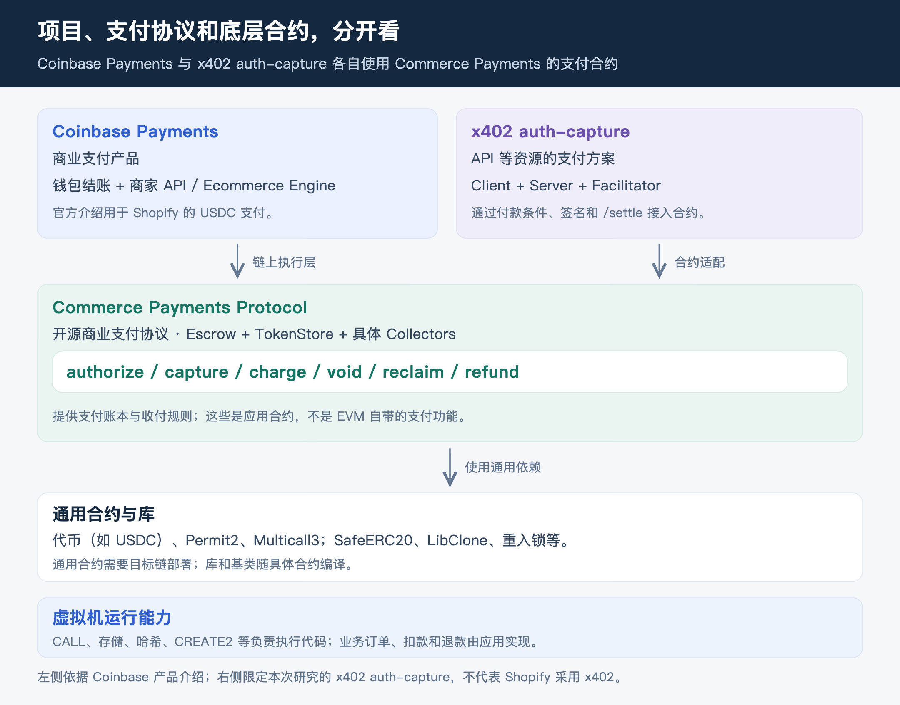
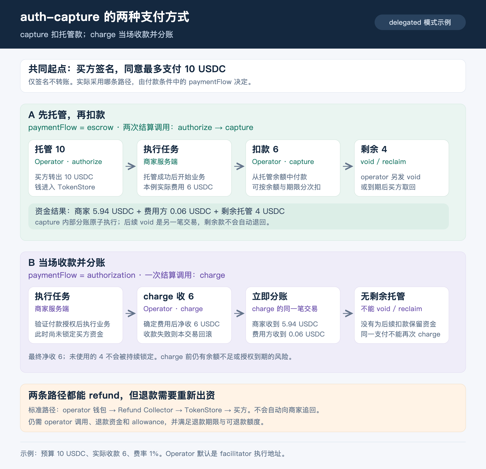
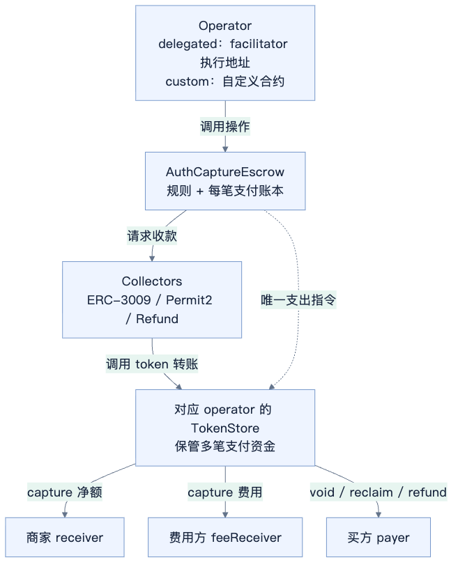
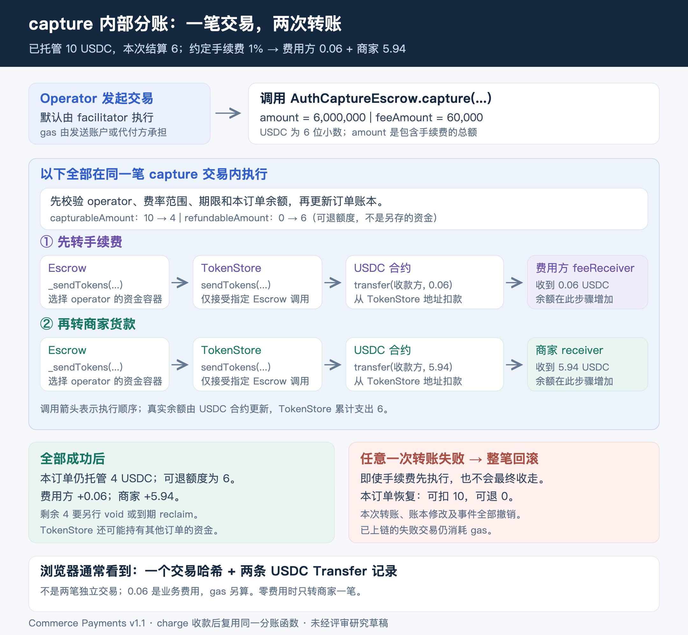
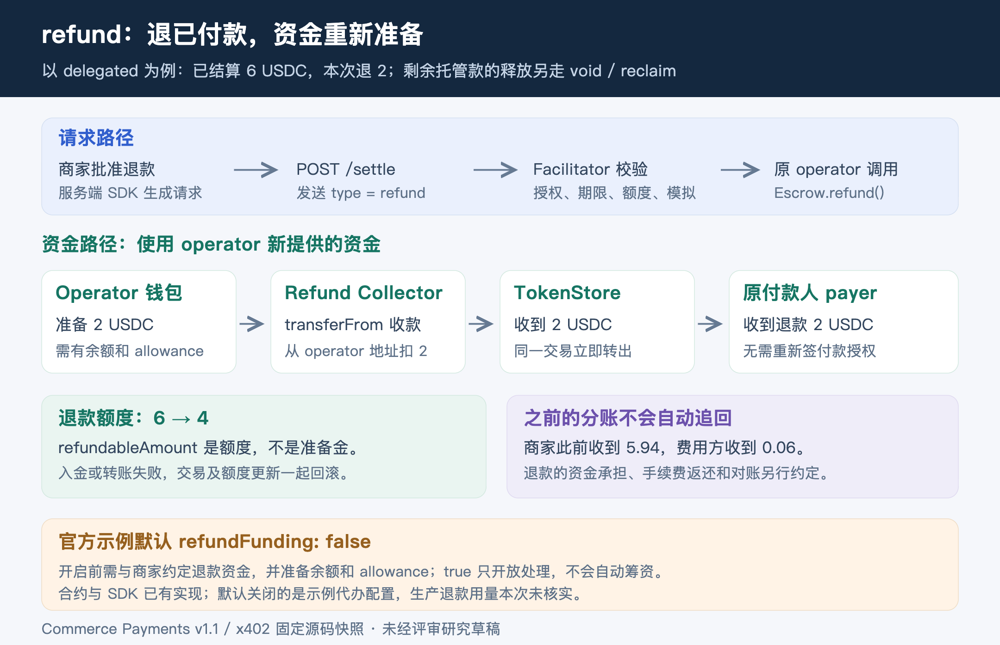
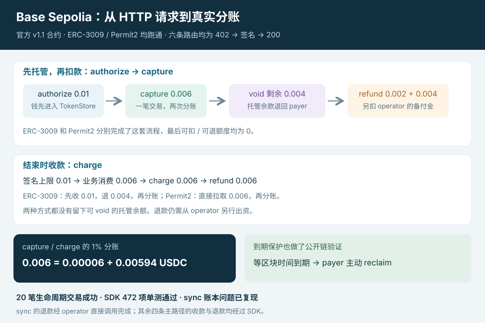

# x402 auth-capture：支付机制与合约分享

更新：2026 年 10 月 20 日。[总目录](../README.md) · [合约源码](auth-capture-solidity-walkthrough.md) · [SDK 与 TRON 接入](auth-capture-official-code-walkthrough.md)

**auth-capture 让用户先同意一笔支付上限，再按实际金额结算。** 商家可以先锁住资金再开工，也可以先拿到签名，等业务完成后一次收款并分账。下面都用“上限 10 USDC、实际消费 6、费用 1%”这个例子。

## 1 Commerce Payments 与 x402

Commerce Payments 是 Coinbase 与 Shopify 推出的开源商业支付协议，提供托管、扣款、取消和退款合约。实现位于 [base/commerce-payments](https://github.com/base/commerce-payments)。x402 是 API 等资源的支付协议；它的 auth-capture 方案接入这套合约。Coinbase Payments 则是包含结账和商家 API 的商业产品。[官方产品介绍](https://www.coinbase.com/en-gb/blog/powering-the-future-of-ecommerce-introducing-coinbase-payments)

Escrow、TokenStore、Collector 是支付系统的配套合约，不是 EVM 自带的功能。x402 的[官方 EVM 规范](https://github.com/x402-foundation/x402/blob/faa1c694c66a3732aaabbce93bdae140e521a67d/specs/schemes/auth-capture/scheme_auth_capture_evm.md)复用 Commerce Payments，新增工作主要在 SDK。Shopify 使用的是这套支付合约，与是否采用 x402 HTTP 接口是两回事。[合约来源和新增代码](auth-capture-solidity-walkthrough.md#11-支付合约与通用依赖)

## 2 为什么有 authorize → capture 和 charge 两条路

| 对比 | exact | authorize → capture | charge |
| --- | --- | --- | --- |
| 用户签什么 | 固定金额 6 | 上限 10 | 上限 10 |
| 开工前 | 签名本身不锁钱 | authorize(10)，先锁住 10 | 签名本身不锁钱 |
| 业务完成后 | 按固定金额支付 6 | capture(6)，剩余 4 另行释放 | charge(6)，当场收款并分账 |
| TokenStore | 图中 ERC-3009 直付路径不经过它 | 钱先留下，稍后结算 | 收进来，同一交易分出去 |
| 取消 / 退款 | 商家可另行转账退款，无本方案退款账本 | 剩余款 void / 到期 reclaim；已付款 refund | 无剩余款，无需 void；已付款 refund |

成本高或耗时长的任务适合先锁钱。对于较短的请求，如果商家能接受最后扣款失败的风险，可以用 charge，省掉单独锁款的交易。charge 能覆盖部分 exact 场景，但客户端和 facilitator 都要支持 auth-capture，也要安排好 operator 权限，不能只改一个配置就替换 exact。

**两条路都会经过 TokenStore，差别是钱会不会留在那里等后续结算。** 签名不等于资金保障，charge 执行时仍可能余额不足或授权过期。

同样是净付 6，实际转账过程还取决于收款方式。Permit2 直接收 6；ERC-3009 Collector 先收上限 10，在同一交易中退回 4，再把 6 存入 TokenStore，因此执行时钱包仍需有 10 的余额。

auth-capture 适合异步任务、按用量计费，以及一笔授权内分次付款。每笔支付有上限和期限，只能首次收款一次，不能充值，也不能据此长期自动续费。

## 3 合约和参与方

| 组件 | 职责 |
| --- | --- |
| AuthCaptureEscrow | 保存订单余额，限制操作人、金额、费用和期限 |
| 具体 Collector | 把外部资金收进 TokenStore：ERC-3009 / Permit2 收用户款，Refund Collector 收 operator 的退款资金 |
| TokenStore | 持有资金，只接受指定 Escrow 的支出指令 |

TokenCollector 是三个具体 Collector 的抽象基类，没有独立的中转地址。继承的入口检查调用者，子类负责实际收款；Escrow 再核对 TokenStore 的实际到账金额。[继承与调用图](auth-capture-solidity-walkthrough.md#8-tokencollector-与具体-collector)

PaymentInfo 保存固定条款，PaymentState 记录是否收过款、剩余可扣托管款、已扣未退额度这三项状态。修改条款会变成另一笔支付，退完钱也不会重置收款标记。多笔订单可以共用同一个 operator 的 TokenStore，Escrow 仍按订单分别记账。

payer 是付款及退款接收人，receiver 是商家货款接收地址，对应 HTTP 条件的 payTo；feeReceiver 是费用地址，不必与二者相同。receiverAuthorizer 是商家操作签名地址，可以自管，也可以经过认证委托给 facilitator。

operator 是合约认定的操作地址。除 payer 调用 reclaim 外，五个资金操作都只允许 operator 调用。默认 delegated 模式下，operator 是 facilitator 控制的提交地址，可以是 EOA 或智能账户。商家通过签名或经过认证的委托请求，告诉它要扣多少钱。

**基础 Escrow 不判断业务是否交付，也不验证商家的操作签名；这层校验由 facilitator 做。** 需要链上规则或仲裁时，可以使用 custom operator，后续操作通过它自己的接口执行，不由 x402 relay 代办。当前 SDK 的 policy 类型仍未开放使用。

六种操作、参数、逐层 msg.sender 和源码行号见[Solidity 走读](auth-capture-solidity-walkthrough.md)。

## 4 capture 怎么分账

capture 总额为 6，手续费是 0.06，商家收到 5.94。Escrow 先把本订单的可扣余额从 10 改为 4、可退额度从 0 改为 6，再指令 TokenStore 依次支付费用方和商家。USDC 从 TokenStore 地址转出，不会再扣用户钱包。

这是一笔交易中的两次 ERC-20 转账，浏览器通常显示一个哈希、两条 Transfer 记录。任一步失败，前面的分账、订单记账和事件一起回滚；失败交易仍消耗 gas。费用包含在 6 内，gas 由发送账户或代付方另付。

费率受用户签署的条款限制。合约支持零费用，没有额外写死的协议费；charge 收款后也使用同一个分账函数。capture 后再 void 剩余 4，需要另一笔交易。因此 capture 成功，并不能证明剩余款已经退回。[源码解释](auth-capture-solidity-walkthrough.md#9-capture把可扣余额转换为可退额度)

## 5 void、reclaim 与 refund

- **尚未花掉的 4**：operator 通过 void 全部退回；到达扣款期限后，payer 可以主动 reclaim。
- **已经付出去的 6**：走 refund，可部分、多次退款，但不能超过已扣未退额度，必须早于退款截止时刻。

标准退款要从 operator 钱包另收一笔资金，经 TokenStore 退给原 payer，因此 operator 需要有余额和 allowance。合约不会自动追回商家已经收到的 5.94 和费用方的 0.06；手续费是否返还、如何与商家对账，要另外约定。**refundableAmount 是额度，不是准备金。**

官方合约和 SDK 已实现 refund，也有对应测试。facilitator 示例默认 refundFunding=false，接入方需要先约定退款资金由谁承担，再开放退款。各部署是否开启退款，要看实际配置。[退款接入](auth-capture-official-code-walkthrough.md#8-退款如何接入)

合约到期后不会自动转账。facilitator 不可用时，payer 只能等到期后 reclaim 尚未结算的余额，不能追回已付款。旧订单固定了 operator，换一家 facilitator 通常无法接管。交易已经广播却不知结果时，应先查原交易和链上状态。

## 6 x402 如何驱动合约

商家服务端在业务路由的 extra 中选择路径，客户端根据 402 返回的付款条件签名：

| 配置 | 官方 SDK 的处理顺序 |
| --- | --- |
| paymentFlow="escrow"（默认） | /settle 调 authorize → 执行业务 → /settle 调 capture |
| paymentFlow="authorization" | /verify → 执行业务 → /settle 调 charge |

escrow 的 captureMode="sync" 默认在请求结束阶段扣款，"deferred" 则稍后扣款；charge 不设置 captureMode。/escrow、/charge 只是示例名称，真实业务接口可以自行命名。

/settle 也处理 capture、void、refund 等后续操作，协议没有另外规定 /refund HTTP 接口。authorize 成功表示钱已托管，capture / charge 成功才表示已经付款。接口、签名、状态存储和失败恢复见[SDK 与接口走读](auth-capture-official-code-walkthrough.md)。

## 7 TRON 上要做什么

建议首版限定为 USDT + Permit2 + 单一 delegated operator。需要移植 Escrow、TokenStore、Permit2PaymentCollector、OperatorRefundCollector，以及配套 SDK 和 facilitator；仅复制 Escrow 不够。

写一个 3009 Collector，不会让现有 USDT 获得签名收款能力。移植时要验证 CREATE2 地址预测、Permit2 接口与签名、TVM 编译依赖，以及 Energy、交易模拟和对账。具体步骤见[TRON 适配](auth-capture-official-code-walkthrough.md#11-tron-适配)。

## 8 应用案例

| 案例 | 用法 | 接入情况 |
| --- | --- | --- |
| [Shopify / Coinbase Payments](https://www.coinbase.com/en-gb/blog/powering-the-future-of-ecommerce-introducing-coinbase-payments) | 商业支付使用 Commerce Payments 的托管与结算合约 | 未确认采用 x402 HTTP 方案，产品开放的功能也不等于合约全部能力 |
| [Execution Market](https://docs.execution.market/payments/escrow) | 项目自述通过 x402r 托管任务赏金，交付后释放 | 订单量和生产退款用量未独立核实 |
| [x402r](https://www.x402r.org/) | 提供 operator 和仲裁扩展 | 官网当时标注 beta，与上游默认 delegated 模式需分别看待 |
| [Circle Arc 电商 demo](https://github.com/circlefin/arc-ecommerce-payments/blob/master/README.md) | 在测试网展示六种操作 | 测试网演示可供参考，商业化和交易规模未核实 |

资料更新到 2026 年 10 月 19 日。[Shopify USDC 产品说明](https://help.shopify.com/en/manual/payments/shopify-payments/local-payment-methods/usdc-payments)当时不支持部分扣款或订阅商品。退款功能有实现，生产使用情况还需要查实际交易。

## 9 实际验证和演示

2026 年 10 月 20 日，用本地已有的测试钱包，在 **Base Sepolia 官方 v1.1 合约**上完成了 20 笔生命周期交易。付款人与 operator 分开，用 0.01 USDC 授权、0.006 USDC 扣款，费用为 1%。

| 验证 | 结果 |
| --- | --- |
| 部署和源码 | Escrow、三个 Collector、TokenStore 模板均有代码，绑定关系正确；重新编译后执行字节码匹配，Collector 编译元数据差异单独保留 |
| 官方 Solidity 测试 | 112 项通过；Foundry v1.3.6、Solidity 0.8.28，其中 94 项 fuzz 测试共 24,064 轮；不含上游 Base 主网 fork 集成测试 |
| 官方 SDK 单测 | 15 个文件、472 项通过，0 失败、0 跳过 |
| 公开测试网 | ERC-3009 / Permit2 的 authorize、capture、void、charge、refund 均实际执行；payer 等公共链期限到达后发出 reclaim |
| HTTP 支付 | 六条业务路由均走过 402 → 客户端签名 → 重试 → 200；sync 后的退款发现一个 SDK 账本问题，见下文 |
| 本地故障验证 | 固定区块 fork 上另跑 9 笔生命周期交易、15 项拒绝与回滚检查 |

**分账可以直接看[这笔 capture 回执](https://sepolia.basescan.org/tx/0x35ccaced4b751ed4a930d9883860f1955ece4c910cf9dd0d1fe7857d3e1307b3)**：TokenStore 同时转出 0.00006 USDC 给费用方、0.00594 USDC 给商家。[refund 回执](https://sepolia.basescan.org/tx/0x96f3c7ef107198ca95635ba2ae8a88b141923ce3dfdbdc27e133b29d245c8047)则从 operator 新收退款，商家和费用方保留原到账金额。两种 Collector 的 deferred 和 charge 路径，收款与退款均经过官方 SDK。

**实测也发现了问题：sync 收款成功后，SDK 的本地账本仍停在授权状态。** 链上已经扣款并释放余款，本地却显示“可扣 0.01、可退 0”，后续 refund helper 因状态不符而拒绝。这笔退款最后由 operator 直接调用 Escrow 完成，不能算 SDK 退款通过。[原因与复现](auth-capture-official-code-walkthrough.md#124-公开测试网与-http-支付)

本地 fork 还验证了商家转账失败时，手续费、订单余额和 TokenStore 部署一起回滚。公开测试网没有修改 USDC 管理权限。Foundry v1.8.5 的一个 Permit2/ERC-6492 用例失败，官方 CI 固定的 v1.3.6 全部通过。

[运行命令和公开交易](auth-capture-official-code-walkthrough.md#12-运行验证与演示) · [公开链原始记录](../demos/auth-capture/results/public-demo.json) · [两家 RPC 复核](../demos/auth-capture/results/public-audit.json) · [演示页面源码](../demos/auth-capture/report.html)

## 10 源码版本

| 项目 | 源码提交 | 内容 |
| --- | --- | --- |
| [x402-foundation/x402](https://github.com/x402-foundation/x402/tree/faa1c694c66a3732aaabbce93bdae140e521a67d) | faa1c694c66a3732aaabbce93bdae140e521a67d，2026-10-15 UTC | TypeScript SDK、规范、示例与测试源码 |
| [base/commerce-payments](https://github.com/base/commerce-payments/tree/b748fdd7a830a655a19a530edcf2a94b9dc7d25f) | b748fdd7a830a655a19a530edcf2a94b9dc7d25f，2026-09-03 UTC | Commerce Payments v1.1 合约与测试源码 |

EVM 合约、SDK 与公开测试网结果见上一节。公开链演示使用 EOA 和商家自行签署操作授权；TRON 尚未完成编译、测试或部署验证，生产退款用量也未核实。函数链接指向上述源码提交，main 中的功能不一定已发布到 npm。

EVM 部分以 v1.1 的 feeAmount 为准，v1.0 使用 feeBps。切换版本时，部署地址、Collector、ABI 和操作签名都要配套，不能只改参数名称。

[合约走读](auth-capture-solidity-walkthrough.md) · [SDK 与 TRON 接入](auth-capture-official-code-walkthrough.md) · [配图与可编辑图源](../assets/auth-capture/README.md)
