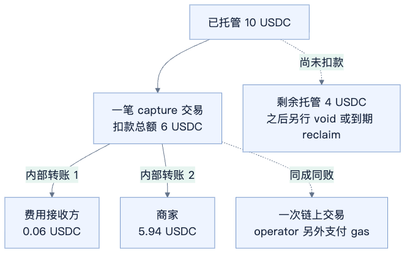
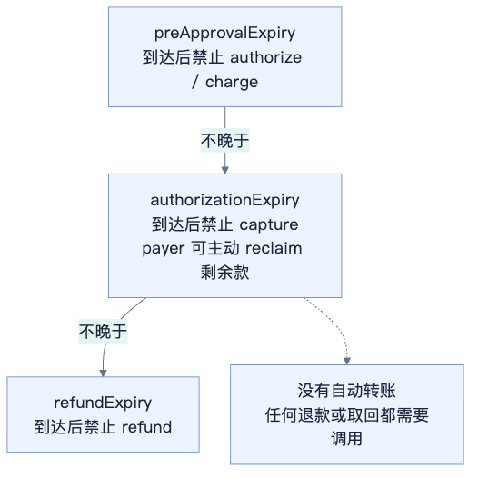

# x402 auth-capture 支付机制与合约分享

> 未经评审的研究草稿。合约测试、链上交易及 TRON 移植尚未验证。

更新：2026 年 10 月 20 日。

auth-capture 用来处理“先准备好钱，稍后再结算”的支付。比如 Agent 做一个预算 10 USDC 的任务：先托管 10，完成后实际扣 6，再退回剩余 4。

上图对比 delegated 模式的两条路径：escrow 先 authorize 托管，再 capture；authorization 直接 charge 收款并分账。两者都可 refund，但 charge 没有剩余托管款可 void 或 reclaim。费用按 1% 举例。

它适合异步任务、按用量计费和一次会话内分次扣款。**每笔支付有额度和期限，不能反复充值，也不是长期自动续费。**

## 谁来操作

买方是 payer，商家收款地址是 receiver。operator 是直接调用合约的地址；默认 delegated 模式里，就是 facilitator 的执行地址。商家通过签名或经过认证的委托请求决定扣多少、是否撤销或退款。

基础 Escrow 只检查 operator 权限和付款条款，不判断任务是否完成，也不验证商家的操作签名。delegated 模式由 facilitator 验证商家意图；需要链上验签或仲裁时，可以用自定义合约担任 operator。

## 合约怎么分工

| 合约 | 职责 |
| --- | --- |
| AuthCaptureEscrow | 记每笔支付的账，限制操作人、金额、费用和期限 |
| ERC3009PaymentCollector | 使用 token 的签名授权收款 |
| Permit2PaymentCollector | 通过 Permit2 收款，首次仍需准备 token allowance |
| OperatorRefundCollector | 标准退款路径从 operator 钱包收钱 |
| TokenStore | 保管托管款，只接受 Escrow 的支出指令 |

这些合约来自 Base 的 Commerce Payments，x402 负责把它们接入 HTTP 支付。

**TokenStore 按 operator 地址区分，不是每笔订单一个。** 同一条链、同一 Escrow 下，多笔支付共用资金容器，Escrow 按支付编号分别记账。Escrow 部署时创建模板；实例地址可提前计算，首次需要转出资金时再自动部署。一个 facilitator 使用多个执行地址，就会对应多个 TokenStore。

## 主合约管什么

PaymentInfo 是固定条款，PaymentState 是余额账本。合约把条款、链 ID 和 Escrow 地址算成 paymentInfoHash，作为支付编号。后续操作必须传回原条款，修改收款人或期限会变成另一笔支付。

| PaymentInfo 参数 | 含义 |
| --- | --- |
| operator / payer / receiver / token | 谁操作、谁付款、谁收款、用什么币 |
| maxAmount | 首次收款上限，使用代币最小单位 |
| preApprovalExpiry | 首次收款截止时间 |
| authorizationExpiry | 扣款截止时间；到达后买方可 reclaim |
| refundExpiry | 退款截止时间 |
| minFeeBps / maxFeeBps | 手续费率范围，100 bps = 1% |
| feeReceiver | 非零时固定费用地址；零时允许 operator 在扣款时指定 |
| salt | 区分不同支付；协议也可用它承诺授权地址等信息 |

三个期限满足：首次收款截止 ≤ 扣款截止 ≤ 退款截止。到达截止时刻，对应操作即失效。

PaymentState 只存三个字段：

- hasCollectedPayment：是否收过钱，全部退完也不重置。
- capturableAmount：剩余可扣的托管款。
- refundableAmount：已扣款中尚可退的额度，**不是另存的一笔退款准备金**。

| 函数 | 调用者 | 钱怎么动 |
| --- | --- | --- |
| authorize | operator | 买方 → 托管，建立可扣余额 |
| capture | operator | 托管 → 商家及费用方，可分次执行 |
| charge | operator | 同一笔交易内收款并分账，不留待扣余额 |
| void | operator | 退回全部剩余托管款 |
| reclaim | payer | 扣款到期后，取回全部剩余托管款 |
| refund | operator | 重新提供退款资金，退给买方 |

### capture 和 charge 有什么区别

两者都按实际金额向商家付款、分手续费，并增加可退款额度。区别是：**capture 扣已经托管的钱，charge 当场从买方收钱再分账。**

例如预算上限 10 USDC，实际费用 6：

- authorize → capture：先托管 10，再扣 6；剩余 4 另行 void 或到期 reclaim。可以在余额和期限内分次 capture。
- charge：一次净收 6 并分账，没有剩余托管款；同一支付不能再次 charge。

需要开工前保证资金到位，就先 authorize 再 capture。charge 没有提前锁钱，即使预验证通过，收款时仍可能因余额不足或授权过期失败。exact 通常用于确定金额的直接支付，方案本身没有这里的费用分账和退款账本。

authorize 或 charge 对同一支付只能成功一次。capture 不能超过剩余托管款；refund 不能超过已扣且未退的金额，也不会恢复可扣余额。void 不能取消尚未收款的 token 签名。

合约收钱后会核对 TokenStore 的实际入金。各操作有重入保护，转账失败时，账本修改和转账一起回滚。

## x402 怎么驱动合约

客户端请求业务 API，收到 402 和 PAYMENT-REQUIRED 付款条件后签名，再携 PAYMENT-SIGNATURE 重试。服务端把支付数据交给 facilitator。

| 接口 | 作用 |
| --- | --- |
| GET /supported | 查询支持的链、方案和配置 |
| POST /verify | 检查、验签和模拟，不收钱 |
| POST /settle | 提交链上操作并处理交易结果 |

具体请求与交易顺序见[两次 settle 时序图](../assets/auth-capture/03-settle-sequence.png)。

默认 escrow 路径通常分两次 settle：第一次调用 authorize，确认托管；业务完成后，第二次调用 capture，实际付给商家。captureMode=sync 在请求结束阶段扣款，deferred 由应用稍后发起。

同一个 /settle 也处理 payload.type 为 capture、void、refund 的操作；paymentFlow=authorization 则执行 charge，一次收款并分账。**settle 成功的含义要看它执行了什么，authorize 成功还不代表商家已收到钱。**

官方 SDK 的 authorization 路径在业务处理后的结算阶段执行 charge，由服务端补齐金额、费用和操作授权。

## 手续费怎么付

托管 10 USDC，本次扣 6、手续费 1%：商家收到 5.94，费用方收到 0.06，剩余 4 继续托管。买方不用另转一笔手续费。

货款和费用是**一笔 capture 里的两次内部转账**，一起成功或回滚。合约支持零费率，也没有额外写死的协议费。gas 另由发交易的账户或代付方承担。

capture 后再 void 剩余款，才是两笔独立交易。官方 SDK 对后续 void 尽力执行，capture 成功不能当成剩余款已退回的证明。

已经付给商家的钱，要通过 refund 退。标准路径由 operator 重新出资，不会自动从商家或费用方追回。

## Facilitator 挂了怎么办

合约不会自动退款。已托管的钱，原 operator 可以继续扣款或撤销；扣款到期后，买方可以主动 reclaim 剩余款，需要原始 PaymentInfo 和 gas 或代付。

已扣给商家的部分不能 reclaim。交易已经广播但结果不明时，要先查原交易和链上余额，避免重复付款。换一家 facilitator 通常也不能接管旧支付，因为 operator 地址已固定。

商家已交付却没及时 capture，也可能错过扣款期限。

## 实际应用

| 案例 | 能说明什么 |
| --- | --- |
| [Shopify / Coinbase Payments](https://www.coinbase.com/en-gb/blog/powering-the-future-of-ecommerce-introducing-coinbase-payments) | 商业支付使用 Commerce Payments 托管和结算；不能据此说它使用 x402 HTTP 接口 |
| [Execution Market](https://docs.execution.market/payments/escrow) | 项目文档描述通过 x402r 托管任务赏金、交付后释放；未独立验证订单量 |
| [x402r](https://www.x402r.org/) | 提供 operator 和仲裁扩展，官网标注 beta |
| [Circle Arc 电商 demo](https://github.com/circlefin/arc-ecommerce-payments/blob/master/README.md) | 测试网展示六种操作，可参考代码，不代表商业规模 |

资料核对于 2026 年 10 月 19 日。[Shopify 的 USDC 产品](https://help.shopify.com/en/manual/payments/shopify-payments/local-payment-methods/usdc-payments)不支持部分扣款或订阅商品，产品开放范围与合约能力要分开看。

## TRON 上要改什么

模型可以沿用，但不能只复制 Escrow。USDT + Permit2 首版需要移植 Escrow、TokenStore、Permit2PaymentCollector 和 OperatorRefundCollector，并接入 TRON SDK 与 facilitator。

重点核对：

- **CREATE2 地址预测**：TRON 使用 0x41 推导前缀，EVM 使用 0xff。TokenStore 先入金后部署，预测和实际地址必须一致。
- **签名与收款**：地址、chainId、PaymentInfo 哈希、Permit2 接口和 allowance 要匹配；现有 exact 的 witness 不能直接替代本方案 nonce。
- **执行与依赖**：验证编译器、重入锁、ERC-6492 / Multicall3 依赖，以及 Energy、模拟、回执和 pending 恢复。

移植方案尚未验证，具体兼容差异见 [TRON 官方说明](https://developers.tron.network/docs/tvm-vs-evm)。

## 源码

逐函数解释、参数细节和测试入口见[官方代码走读](auth-capture-official-code-walkthrough.md)。[全部配图及可编辑图源](../assets/auth-capture/)可单独使用。

本文依据 x402 提交 faa1c694c66a3732aaabbce93bdae140e521a67d 和 Commerce Payments 提交 b748fdd7a830a655a19a530edcf2a94b9dc7d25f，以 v1.1 为主。v1.0 扣款参数是 feeBps，v1.1 是 feeAmount，升级时必须配套核对部署、Collector、ABI 和签名配置。
