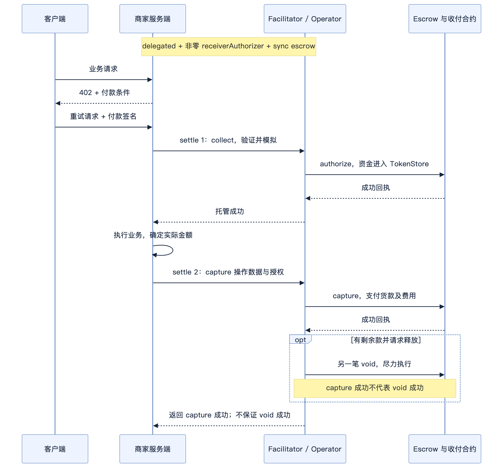

# x402 auth-capture SDK 与接口走读

> 未经评审的研究草稿。TypeScript 静态源码分析，未运行 SDK 测试或链上交易。

更新：2026 年 10 月 20 日。[总目录](../README.md) · [分享主稿](auth-capture-contract-analysis.md) · [基础概念](auth-capture-foundations.md) · [合约源码](auth-capture-solidity-walkthrough.md) · [TRON 适配](auth-capture-tron-port.md)

本文从付款条件和签名进入 SDK，跟到 facilitator 调用合约、保存状态和处理重试。合约函数内部实现统一放在 Solidity 走读；固定提交及验证范围见[来源说明](auth-capture-foundations.md#6-源码版本与验证范围)。

## 1 代码入口与职责

| 导入 / 文件位置 | 负责什么 |
| --- | --- |
| auth-capture/client/scheme.ts | 根据付款条件构造用户 token 授权 |
| auth-capture/server/scheme.ts | 形成条款、选择路径和 authorizer 配置 |
| server/settlementHooks.ts | 在业务前后补齐结算数据、记录结果 |
| server/lifecycleManager.ts | 对存储订单发起 capture / void / refund |
| facilitator/collect.ts | 初次收款的验证、模拟、提交和对账 |
| facilitator/lifecycle.ts | 后续生命周期的验证与提交 |
| nonce.ts、lifecyclePayload.ts | 支付身份、nonce 及商家操作授权数据 |

client、server、facilitator 都有名为 AuthCaptureEvmScheme 的类，实现的是不同接口，导入入口不能混用。它们最终接入已有 Commerce Payments 合约，不是三套链上 Escrow。

## 2 HTTP 接口与操作分派

客户端首次请求业务 API，服务端返回 402 和 PAYMENT-REQUIRED；客户端签名后携 PAYMENT-SIGNATURE 重试。服务端与 facilitator 使用以下接口：

| 接口 | 请求 / 返回重点 | 是否移动资金 |
| --- | --- | --- |
| GET /supported | 支持的 scheme / network、operator 及费用等配置 | 否 |
| POST /verify | 请求体包含 paymentPayload、paymentRequirements；返回验证结果 | 否 |
| POST /settle | 使用同样两项请求对象，提交操作并返回交易结果 | 按实际操作决定 |

| payload 与付款条件 | 实际合约操作 |
| --- | --- |
| collect，无 payload.type，paymentFlow="escrow" | authorize |
| collect，无 payload.type，paymentFlow="authorization" | charge，服务端需补齐金额、费用和操作授权 |
| payload.type="capture" / "void" / "refund" | 对应生命周期函数 |

没有单独规定 /capture、/void、/refund HTTP 接口。/settle 成功也不一定表示商家已收钱：authorize 只是建立托管。/verify 不保证以后一定能收款，settle 会重新验证并模拟。

下图限定为 delegated、可代办生命周期的 sync escrow 路径；charge 和 custom 的分支见下文。



## 3 服务端选择路径与期限

源码：[async enhancePaymentRequirements(](https://github.com/x402-foundation/x402/blob/faa1c694c66a3732aaabbce93bdae140e521a67d/typescript/packages/mechanisms/evm/src/auth-capture/server/scheme.ts#L228)；[async enrichSettlementPayload(](https://github.com/x402-foundation/x402/blob/faa1c694c66a3732aaabbce93bdae140e521a67d/typescript/packages/mechanisms/evm/src/auth-capture/server/settlementHooks.ts#L80)；[private async persistCollect(](https://github.com/x402-foundation/x402/blob/faa1c694c66a3732aaabbce93bdae140e521a67d/typescript/packages/mechanisms/evm/src/auth-capture/server/settlementHooks.ts#L255)。

server.enhancePaymentRequirements 合并 facilitator 与商户配置，并解析部署、期限和支付路径；它明确拒绝旧 autoCapture 字段。相对期限会转换为绝对期限，不能在后续扣款时改用新期限重建订单。

paymentFlow 由服务端业务路由的 extra 设置：escrow（默认）将初次 collect 解释为 authorize；authorization 将其解释为 charge。captureMode 的 sync / deferred 仅适用于 escrow，authorization 不得设置。客户端根据选中的付款条件生成签名，不另传一个 type="charge" 来自主改变路径；/escrow 与 /charge 只是示例路由名，并非协议接口。

settlementHooks 的 before-handler 不追加商户扣款签名；authorize 成功后的 handleAfterSettle 保存完整 PaymentInfo、saltNonce、支付 key、收款交易和余额。after-handler 为 sync escrow 构造 capture，为 authorization 路径补齐 charge；deferred escrow 跳过请求结束时扣款，保留已托管结果。cancel 对可代办生命周期的 escrow 路径构造 void。

这些阶段解释依据 scheme hooks 及其测试，本文未展开全部 core HTTP middleware 调度源码。SDK 发起操作不能归为合约自带的自动执行。

| extra 主要参数 | 对应意义 |
| --- | --- |
| captureAuthorizer | 链上 operator；delegated 通常从 /supported 获得 |
| receiverAuthorizer | 商家操作授权的签名地址；charge 和代办生命周期需要非零 |
| captureDeadline / refundDeadline | 对应 PaymentInfo.authorizationExpiry / refundExpiry |
| captureDeadlineSeconds / refundDeadlineSeconds | 服务端可配置的相对期限，由增强阶段转成绝对时间 |
| feeRecipient / minFeeBps / maxFeeBps | 费用地址和范围 |
| assetTransferMethod | eip3009（默认）或 permit2，决定配套 Collector |

SDK 支持相对期限不代表后续操作可以延期。订单形成后必须保留原始 PaymentInfo；charge 属于首次收款，仍受用户签名中的 preApprovalExpiry 限制。

## 4 客户端签什么，nonce 如何绑定条款

入口：[async createPaymentPayload(](https://github.com/x402-foundation/x402/blob/faa1c694c66a3732aaabbce93bdae140e521a67d/typescript/packages/mechanisms/evm/src/auth-capture/client/scheme.ts#L61)；地址承诺：[export function deriveBoundSalt(](https://github.com/x402-foundation/x402/blob/faa1c694c66a3732aaabbce93bdae140e521a67d/typescript/packages/mechanisms/evm/src/auth-capture/nonce.ts#L381)。

createPaymentPayload 校验协议版本与必填 extra，解析网络和部署，再把 requirements 转成 Solidity 字段名称的 PaymentInfo。preApprovalExpiry 从当前时间加 maxTimeoutSeconds 得出；facilitator 后续重建时从签名中的 validBefore/deadline 读取，不能重新取当前时间计算。

客户端生成随机 saltNonce。receiverAuthorizer 或 policy 非零时，salt 是带 SALT_BINDING_TYPEHASH 的地址承诺；否则 salt 就是随机值，不附加 saltNonce。绑定启用时两者都要保留：salt 进入链上条款，saltNonce 用来验证承诺。

| 签名路径 | EIP-712 domain | 签名的收款授权 |
| --- | --- | --- |
| ERC-3009 | token 合约，name/version 来自 token 域参数 | ReceiveWithAuthorization，to 为匹配部署的 ERC3009 Collector |
| Permit2 | canonical Permit2 合约 | PermitTransferFrom，spender 为匹配部署的 Permit2 Collector |

此处一次付款签名只同意收款条款，不代表买方又签了每次 capture。后续扣款靠 operator 权限执行；费用和时间等仍受条款限制。

### 支付哈希与签名 nonce

源码：SDK [function hashPaymentInfo(](https://github.com/x402-foundation/x402/blob/faa1c694c66a3732aaabbce93bdae140e521a67d/typescript/packages/mechanisms/evm/src/auth-capture/nonce.ts#L45)，合约 [function getHash(](https://github.com/base/commerce-payments/blob/b748fdd7a830a655a19a530edcf2a94b9dc7d25f/src/AuthCaptureEscrow.sol#L383)，Collector [function _getHashPayerAgnostic(](https://github.com/base/commerce-payments/blob/b748fdd7a830a655a19a530edcf2a94b9dc7d25f/src/collectors/TokenCollector.sol#L70)。

```text
H(info) = keccak256(abi.encode(
  chainId,
  escrowAddress,
  keccak256(abi.encode(PAYMENT_INFO_TYPEHASH, info))
))

paymentInfoHash = H(真实 payer 的 PaymentInfo)
signatureNonce  = H(payer 置零后的 PaymentInfo)
```

客户端 hashPaymentInfo 使用 encodeAbiParameters；合约 getHash 使用 abi.encode。字段类型、顺序、typehash 和外层 chainId、escrow 地址必须一致。这里是自定义支付标识的哈希规则，不能直接替换成带 0x1901 前缀的通用 EIP-712 digest。

为什么 token nonce 中没有真实 payer？实际付款人仍由 ERC-3009 的 from 或 Permit2 的 owner 及其签名绑定；Collector 将传入 PaymentInfo 的 payer 置零后重算 nonce。两份签名可共享某个 nonce 值不代表签名可跨付款人使用。随机 salt 负责每次付款的新鲜性。

最关键的绑定是：receiver、operator、金额上限、期限、费用都进入 nonce。只拿到 token 签名的人不能修改这些字段后仍通过 canonical Collector 的授权验证。

## 5 Facilitator 验证与合约目标选择

分派：[async verify(](https://github.com/x402-foundation/x402/blob/faa1c694c66a3732aaabbce93bdae140e521a67d/typescript/packages/mechanisms/evm/src/auth-capture/facilitator/scheme.ts#L169)；collect 验证：[export async function verifyCollect(](https://github.com/x402-foundation/x402/blob/faa1c694c66a3732aaabbce93bdae140e521a67d/typescript/packages/mechanisms/evm/src/auth-capture/facilitator/collect.ts#L177)；目标选择：[export function resolveSettleTarget](https://github.com/x402-foundation/x402/blob/faa1c694c66a3732aaabbce93bdae140e521a67d/typescript/packages/mechanisms/evm/src/auth-capture/extra.ts#L329)；operator 准入：[export function validateOperator](https://github.com/x402-foundation/x402/blob/faa1c694c66a3732aaabbce93bdae140e521a67d/typescript/packages/mechanisms/evm/src/auth-capture/extra.ts#L261)。

verify/settle 按 payload.type 区分 collect 与 capture/void/refund。verifyCollect 主要检查：

- scheme、network、extra、operator 与收款方式匹配。
- deadline 次序和剩余有效期；实现预留 6 秒安全余量。
- ERC-3009 to 或 Permit2 spender 与所选部署 Collector 一致。
- 付款签名、金额上限、重建 PaymentInfo 后的 nonce。
- 启用绑定时的 saltNonce 与 salt；charge completion 的金额、费用与商户授权。
- 模拟实际调用是否成功。

智能钱包不是简单 recoverAddress：ERC-1271 失败不能自动回退为 ECDSA 成功；未部署的 ERC-6492 钱包依赖允许的准备目标和 collect 模拟完成验证。预验证可解开内层签名，但提交必须保留 ERC-6492 wrapper 以便链上完成部署准备。

delegated 的 operator 必须为 facilitator 控制的提交地址，调用目标是 Escrow。custom 调用目标是 operator 合约，生命周期不由此 SDK relay。policy 类型在这份实现中仍不作为可用 operator 接受。

| operator 配置 | 官方 relay 范围 | escrow 路由的 captureMode |
| --- | --- | --- |
| delegated，非零 receiverAuthorizer | authorize / charge 及 capture / void / refund；退款另受资金开关限制 | sync 或 deferred |
| delegated，无 receiverAuthorizer 或为零 | 只代办 authorize，后续由 operator 自行处理 | 必须 deferred |
| custom | 只代办 collect（authorize / charge），生命周期走自定义 operator 接口 | 必须 deferred |

charge 在两种 operator 模式下都需要非零 receiverAuthorizer。服务端自管签名地址时，要配置匹配的 receiverAuthorizerSigner；若委托 facilitator 签名，还需下文的调用者认证与订单绑定。

## 6 Custom operator 的模拟与结果核对

源码：[async function simulateCollect(](https://github.com/x402-foundation/x402/blob/faa1c694c66a3732aaabbce93bdae140e521a67d/typescript/packages/mechanisms/evm/src/auth-capture/facilitator/collect.ts#L1093)；[export async function settleCollect(](https://github.com/x402-foundation/x402/blob/faa1c694c66a3732aaabbce93bdae140e521a67d/typescript/packages/mechanisms/evm/src/auth-capture/facilitator/collect.ts#L765)。

custom operator 可以是一个收到调用却什么都没做的合约。simulateCollect 因此要求 simulateCalls，批量观察调用前后状态，并检查 Escrow 事件、paymentState 和余额变化，还对 operator 调用设置 gas 上限。

实际广播后的 awaitCollectSettlement 也会核对所需事件和状态；custom 路径额外核对余额。正确目标是“完成约定的收款”，而非仅“交易 receipt 为 success”。

这是 SDK 验证外围合约行为的措施，不表示任意自定义仲裁逻辑已被基础 Escrow 证明正确。

## 7 商家操作签名与委托身份

源码：[export async function buildCaptureFields](https://github.com/x402-foundation/x402/blob/faa1c694c66a3732aaabbce93bdae140e521a67d/typescript/packages/mechanisms/evm/src/auth-capture/lifecyclePayload.ts#L100)；[async function verifyCapturePayload(](https://github.com/x402-foundation/x402/blob/faa1c694c66a3732aaabbce93bdae140e521a67d/typescript/packages/mechanisms/evm/src/auth-capture/facilitator/lifecycle.ts#L864)；[async function signDelegatedLifecycle(](https://github.com/x402-foundation/x402/blob/faa1c694c66a3732aaabbce93bdae140e521a67d/typescript/packages/mechanisms/evm/src/auth-capture/facilitator/lifecycle.ts#L258)；[export async function bindThenBroadcast](https://github.com/x402-foundation/x402/blob/faa1c694c66a3732aaabbce93bdae140e521a67d/typescript/packages/mechanisms/evm/src/auth-capture/facilitator/delegatedAuth.ts#L198)。

buildCaptureFields 将支付 key、金额、费用、预期 capturable/refundable 余额纳入商户操作签名。verifyCapturePayload 验证签名、读取链上余额并与预期值比对，再模拟 capture。余额变化后，旧操作通常无法再次通过同一预期状态检查。

但基础 Escrow.capture 的参数没有 authorizerSignature，也没有 expectedBalances。它只认 operator、金额、费用和期限。因此这里的商户同意与单次执行检查主要是 facilitator 层的规则；读链与写链之间仍存在并发时间窗口，不能写成链上原子比较交换。

当前源码还支持 facilitator 代任 receiver authorizer。这个分支不能因为没有商户签名就直接放行：先 resolveCallerIdentity，在收款时 bind 调用者与支付身份；后续生命周期必须匹配同一绑定身份才能由 facilitator 生成操作签名。bindThenBroadcast 在广播前建立绑定，是否撤销绑定要依据广播结果；结果不明时不能假设交易从未发生。

## 8 退款如何接入

### 官方 SDK 默认如何处理 refund

源码：[refundFunding 配置](https://github.com/x402-foundation/x402/blob/faa1c694c66a3732aaabbce93bdae140e521a67d/typescript/packages/mechanisms/evm/src/auth-capture/types.ts#L202-L212)；[未开启时拒绝](https://github.com/x402-foundation/x402/blob/faa1c694c66a3732aaabbce93bdae140e521a67d/typescript/packages/mechanisms/evm/src/auth-capture/facilitator/lifecycle.ts#L142-L148)；[官方示例默认关闭](https://github.com/x402-foundation/x402/blob/faa1c694c66a3732aaabbce93bdae140e521a67d/examples/typescript/facilitator/auth-capture/index.ts#L133-L135)；[LifecycleManager.refund](https://github.com/x402-foundation/x402/blob/faa1c694c66a3732aaabbce93bdae140e521a67d/typescript/packages/mechanisms/evm/src/auth-capture/server/lifecycleManager.ts#L115-L139)。

官方示例的 refundFunding=false；SDK 在 delegated 退款未开启时返回 invalid_auth_capture_evm_refund_funding_unavailable。原因是退款会花 operator 自己的钱，商户操作签名不能代替商户与 facilitator 的资金协议。设为 true 只开放处理分支，不会自动筹资、approve 或建立商户备付金账本；多提交地址轮转时，每个旧订单对应的 operator 都需要资金和 allowance。

资金安排的协议要求见官方 [Refund funding](https://github.com/x402-foundation/x402/blob/faa1c694c66a3732aaabbce93bdae140e521a67d/specs/schemes/auth-capture/scheme_auth_capture_evm.md#refund-funding)。

有持久化订单记录后，服务端可以调用 lifecycleManager.refund(paymentInfoHash, {amount: "2000000"}) 退 2 USDC（6 位小数）。SDK 构建 type="refund" 的 payload，经同一个 /settle 提交；商户自签模式提供操作签名，委托签名模式按已认证调用者与支付绑定由 facilitator 签。随后检查 refundExpiry、链上两项预期余额、退款额度并模拟，最终以原 operator 调用 Escrow。成功后服务端更新本地可退额度；余额预期的校验在 facilitator，基础 Escrow 没有原子比较这两项预期余额的参数。

退款的额度、资金流和费用处理见[合约 refund](auth-capture-solidity-walkthrough.md#13-refund额度减少新资金再进来)。custom operator 的退款不由官方 facilitator relay。

合约、SDK、测试源码存在，不能当作生产使用证据；示例默认关闭，也不能推出全部部署未开启或无人使用。本次没有核实生产退款交易及用量。

## 9 Pending 重试、剩余款释放与存储

源码：[export async function settleCollect(](https://github.com/x402-foundation/x402/blob/faa1c694c66a3732aaabbce93bdae140e521a67d/typescript/packages/mechanisms/evm/src/auth-capture/facilitator/collect.ts#L765)；[async function settleVerifiedLifecycle(](https://github.com/x402-foundation/x402/blob/faa1c694c66a3732aaabbce93bdae140e521a67d/typescript/packages/mechanisms/evm/src/auth-capture/facilitator/lifecycle.ts#L582)；[async capture(](https://github.com/x402-foundation/x402/blob/faa1c694c66a3732aaabbce93bdae140e521a67d/typescript/packages/mechanisms/evm/src/auth-capture/server/lifecycleManager.ts#L43)；[export interface AuthorizedPaymentStorage](https://github.com/x402-foundation/x402/blob/faa1c694c66a3732aaabbce93bdae140e521a67d/typescript/packages/mechanisms/evm/src/auth-capture/server/storage.ts#L64)。

settleCollect 先检查 pending 交易；缓存命中时对原交易等待与对账，避免直接重广播。collect key 是付款签名。生命周期签名由 facilitator 动态生成时，pending key 按操作内容派生，避免同样操作重签后落到不同 key。pending 不是已确认失败，不能盲目生成新 salt 重新付款。

capture 带剩余款释放意图时，settleVerifiedLifecycle 先等 capture 成功，再单独 submit void。代码明确按 best effort 处理第二笔操作。capture 成功后 void 失败，仍返回 capture 成功，剩余款仍需后续 void 或到期 reclaim。

这里还有本地记录的限制：LifecycleManager.capture 成功后按 opts.voidRemainder 更新本地余额；sync hooks 也按 void 签名是否存在判断清零意图。因此不能把本地 capturable=0 当成第二笔 void 已确认的证明。应结合两笔交易及真实链上 paymentState 理解。这是源码可见的记录与执行差异，本文没有运行故障注入测试。

AuthorizedPaymentStorage.update 要求原子条件修改；默认内存实现的锁只覆盖一个 JS runtime，不能提供跨实例协调。存储原子更新也不等于整个“读记录—发链上交易—更新记录”区间被锁住。

## 10 SDK 测试入口与阅读边界

以下为本次检查的测试源码入口，没有执行测试。合约测试集中见[Solidity 走读](auth-capture-solidity-walkthrough.md#17-读完后去看哪些测试)。

| 官方测试源码 | 可核对的断言 |
| --- | --- |
| [pendingSettlement.test.ts](https://github.com/x402-foundation/x402/blob/faa1c694c66a3732aaabbce93bdae140e521a67d/typescript/packages/mechanisms/evm/test/unit/auth-capture/pendingSettlement.test.ts) | receipt 超时返回 pending，缓存命中不重广播 |
| [settlementHooks.test.ts](https://github.com/x402-foundation/x402/blob/faa1c694c66a3732aaabbce93bdae140e521a67d/typescript/packages/mechanisms/evm/test/unit/auth-capture/settlementHooks.test.ts) | 委托签名 enrichment、deferred 跳过、失败不保存记录 |
| [lifecycleFacilitator.test.ts](https://github.com/x402-foundation/x402/blob/faa1c694c66a3732aaabbce93bdae140e521a67d/typescript/packages/mechanisms/evm/test/unit/auth-capture/lifecycleFacilitator.test.ts) | 拒绝 PaymentInfo 不匹配、salt 绑定错误、错误费用字段 |

合约限制金额、费用、期限和操作人；SDK 组织签名、身份绑定、模拟和重试；交付判断、退款审批、资金备付和对账需要业务系统承担。部署接入 TRON 时，还需替换执行及签名适配，见[TRON 适配](auth-capture-tron-port.md)。

[返回分享主稿](auth-capture-contract-analysis.md) · [查看合约实现](auth-capture-solidity-walkthrough.md) · [来源与验证范围](auth-capture-foundations.md#6-源码版本与验证范围)
