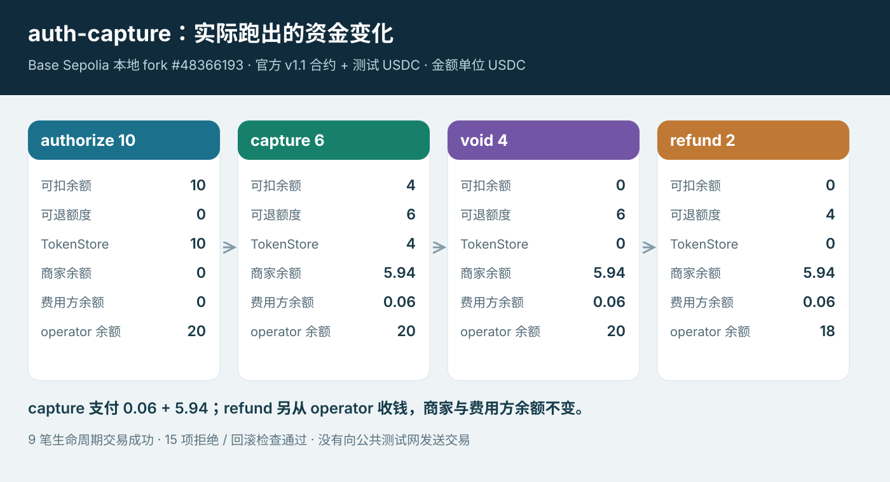

# x402 auth-capture SDK、接口与 TRON 接入

更新：2026 年 10 月 20 日。[总目录](../README.md) · [分享主稿](auth-capture-contract-analysis.md) · [合约源码](auth-capture-solidity-walkthrough.md) · [TRON 适配](#11-tron-适配)

服务端设置付款条件，客户端签名，facilitator 验证并提交交易，业务系统负责交付判断、退款审批、备付金和商户对账。合约内部实现见[合约走读](auth-capture-solidity-walkthrough.md)，[源码版本](auth-capture-contract-analysis.md#10-源码版本)统一列在主稿末尾。

## 1 代码入口与职责

| 导入 / 文件位置 | 负责什么 |
| --- | --- |
| auth-capture/client/scheme.ts | 根据付款条件构造用户 token 授权 |
| auth-capture/server/scheme.ts | 形成条款、选择路径和 authorizer 配置 |
| server/settlementHooks.ts | 在业务前后补齐结算数据、记录结果 |
| server/lifecycleManager.ts | 对存储订单发起 capture / void / refund |
| facilitator/collect.ts | 初次收款的验证、模拟、提交和对账 |
| facilitator/lifecycle.ts | 后续生命周期的验证与提交 |
| nonce.ts、lifecyclePayload.ts | 支付身份、nonce 及商家操作授权数据 |

client、server、facilitator 都有名为 AuthCaptureEvmScheme 的类，但各自实现不同接口，导入时要选对入口。它们最终接入同一套已有的 Commerce Payments 合约，并不是三套链上 Escrow。

[#3203](https://github.com/x402-foundation/x402/pull/3203) 的提交 [28376d6](https://github.com/x402-foundation/x402/commit/28376d643a6d9492e4a6cbfa5199376b90eb89dc)修改了 164 个文件，没有生产 Solidity 合约变更。主要新增或完善 client / server / facilitator 的授权、结算和生命周期管理。abi.ts 是已有合约的接口定义。

新增的 Solidity 只有三个集成测试 operator：ForwardingOperator 转发 authorize / charge；NoopOperator 调用不 revert 却不收款，用于识别假成功；GasWastingOperator 消耗过多 gas，用于检查调用限制。

官方[测试说明](https://github.com/x402-foundation/x402/blob/faa1c694c66a3732aaabbce93bdae140e521a67d/typescript/packages/mechanisms/evm/test/contracts/auth-capture/README.md)限定它们用于集成测试，不能当作生产 operator 模板。

## 2 HTTP 接口

客户端首次请求业务 API，服务端返回 402 和 PAYMENT-REQUIRED；客户端签名后携 PAYMENT-SIGNATURE 重试。服务端与 facilitator 使用以下接口：

| 接口 | 请求 / 返回重点 | 是否移动资金 |
| --- | --- | --- |
| GET /supported | 支持的 scheme / network、operator 及费用等配置 | 否 |
| POST /verify | 请求体包含 paymentPayload、paymentRequirements；返回验证结果 | 否 |
| POST /settle | 使用同样两项请求对象，提交操作并返回交易结果 | 按实际操作决定 |

| payload 与付款条件 | 实际合约操作 |
| --- | --- |
| collect，无 payload.type，paymentFlow="escrow" | authorize |
| collect，无 payload.type，paymentFlow="authorization" | charge，服务端需补齐金额、费用和操作授权 |
| payload.type="capture" / "void" / "refund" | 对应生命周期函数 |

没有单独规定 /capture、/void、/refund HTTP 接口。/settle 成功也不一定表示商家已收钱：authorize 只是建立托管。/verify 不保证以后一定能收款，settle 会重新验证并模拟。

图中是 delegated 模式、有非零 receiverAuthorizer 的 sync escrow 调用过程。charge 和 custom 的处理方式在后面分别说明。


## 3 服务端选择路径与期限

源码：[async enhancePaymentRequirements(](https://github.com/x402-foundation/x402/blob/faa1c694c66a3732aaabbce93bdae140e521a67d/typescript/packages/mechanisms/evm/src/auth-capture/server/scheme.ts#L228)；[async enrichSettlementPayload(](https://github.com/x402-foundation/x402/blob/faa1c694c66a3732aaabbce93bdae140e521a67d/typescript/packages/mechanisms/evm/src/auth-capture/server/settlementHooks.ts#L80)；[private async persistCollect(](https://github.com/x402-foundation/x402/blob/faa1c694c66a3732aaabbce93bdae140e521a67d/typescript/packages/mechanisms/evm/src/auth-capture/server/settlementHooks.ts#L255)。

server.enhancePaymentRequirements 合并 facilitator 与商户配置，解析部署、期限和支付路径，并拒绝旧 autoCapture 字段。相对期限会在这里转成绝对期限；后续扣款必须沿用，不能拿新期限重建订单。

paymentFlow 由服务端业务路由的 extra 设置。默认值 escrow 让初次 collect 执行 authorize；设为 authorization 则执行 charge。captureMode 的 sync / deferred 只用于 escrow，authorization 不得设置。

客户端按选中的付款条件生成签名，不能另传一个 type="charge" 来改变路径。/escrow 与 /charge 只是示例路由名，并非协议接口。

settlementHooks 的 before-handler 不追加商户扣款签名。authorize 成功后，handleAfterSettle 保存完整 PaymentInfo、saltNonce、支付 key、收款交易和余额。

after-handler 为 sync escrow 构造 capture，为 authorization 路径补齐 charge。deferred escrow 则保留已托管结果，不在请求结束时扣款。cancel 会为可代办生命周期的 escrow 路径构造 void。

这些操作由 SDK 发起，合约不会到时自动执行。HTTP 实测发现 sync 后的本地账本更新遗漏，见[公开测试网验证](#124-公开测试网与-http-支付)。

| extra 主要参数 | 对应意义 |
| --- | --- |
| captureAuthorizer | 链上 operator；delegated 通常从 /supported 获得 |
| receiverAuthorizer | 商家操作授权的签名地址；charge 和代办生命周期需要非零 |
| captureDeadline / refundDeadline | 对应 PaymentInfo.authorizationExpiry / refundExpiry |
| captureDeadlineSeconds / refundDeadlineSeconds | 服务端可配置的相对期限，由增强阶段转成绝对时间 |
| feeRecipient / minFeeBps / maxFeeBps | 费用地址和范围 |
| assetTransferMethod | eip3009（默认）或 permit2，决定配套 Collector |

相对期限只在创建订单时换算。之后必须保留原始 PaymentInfo，不能借此延期；charge 是首次收款，仍受用户签名中的 preApprovalExpiry 限制。

## 4 客户端签什么，nonce 如何绑定条款

入口：[async createPaymentPayload(](https://github.com/x402-foundation/x402/blob/faa1c694c66a3732aaabbce93bdae140e521a67d/typescript/packages/mechanisms/evm/src/auth-capture/client/scheme.ts#L61)；地址承诺：[export function deriveBoundSalt(](https://github.com/x402-foundation/x402/blob/faa1c694c66a3732aaabbce93bdae140e521a67d/typescript/packages/mechanisms/evm/src/auth-capture/nonce.ts#L381)。

createPaymentPayload 先校验协议版本与必填 extra，解析网络和部署，再将 requirements 转为字段名称与 Solidity 一致的 PaymentInfo。preApprovalExpiry 等于当前时间加 maxTimeoutSeconds。facilitator 后续重建订单时，要从签名的 validBefore/deadline 读取这个期限，不能按新的当前时间重算。

客户端生成随机 saltNonce。receiverAuthorizer 或 policy 非零时，salt 是带 SALT_BINDING_TYPEHASH 的地址承诺；否则 salt 就是随机值，不附加 saltNonce。绑定启用时两者都要保留：salt 进入链上条款，saltNonce 用来验证承诺。

| 签名路径 | EIP-712 domain | 签名的收款授权 |
| --- | --- | --- |
| ERC-3009 | token 合约，name/version 来自 token 域参数 | ReceiveWithAuthorization，to 为匹配部署的 ERC3009 Collector |
| Permit2 | canonical Permit2 合约 | PermitTransferFrom，spender 为匹配部署的 Permit2 Collector |

用户这次付款签名同意的是收款条款，不需要为之后的每次 capture 再签一次。后续扣款由 operator 执行，费用和时间等仍受条款限制。

### 支付哈希与签名 nonce

源码：SDK [function hashPaymentInfo(](https://github.com/x402-foundation/x402/blob/faa1c694c66a3732aaabbce93bdae140e521a67d/typescript/packages/mechanisms/evm/src/auth-capture/nonce.ts#L45)，合约 [function getHash(](https://github.com/base/commerce-payments/blob/b748fdd7a830a655a19a530edcf2a94b9dc7d25f/src/AuthCaptureEscrow.sol#L383)，Collector [function _getHashPayerAgnostic(](https://github.com/base/commerce-payments/blob/b748fdd7a830a655a19a530edcf2a94b9dc7d25f/src/collectors/TokenCollector.sol#L70)。

```text
H(info) = keccak256(abi.encode(
  chainId,
  escrowAddress,
  keccak256(abi.encode(PAYMENT_INFO_TYPEHASH, info))
))

paymentInfoHash = H(真实 payer 的 PaymentInfo)
signatureNonce  = H(payer 置零后的 PaymentInfo)
```

客户端 hashPaymentInfo 使用 encodeAbiParameters；合约 getHash 使用 abi.encode。字段类型、顺序、typehash 和外层 chainId、escrow 地址必须一致。这里是自定义支付标识的哈希规则，不能直接替换成带 0x1901 前缀的通用 EIP-712 digest。

token nonce 中的 payer 虽然置零，实际付款人仍由 ERC-3009 的 from 或 Permit2 的 owner 及其签名绑定。Collector 也会将传入 PaymentInfo 的 payer 置零后重算 nonce。因此，两份签名即使用了相同的 nonce 值，也不能跨付款人使用。每次付款的随机 salt 用来区分不同支付。

receiver、operator、金额上限、期限和费用都绑定在 nonce 中。即使拿到了 token 签名，修改这些字段后也无法通过 canonical Collector 的授权验证。

## 5 Facilitator 验证什么

分派：[async verify(](https://github.com/x402-foundation/x402/blob/faa1c694c66a3732aaabbce93bdae140e521a67d/typescript/packages/mechanisms/evm/src/auth-capture/facilitator/scheme.ts#L169)；collect 验证：[export async function verifyCollect(](https://github.com/x402-foundation/x402/blob/faa1c694c66a3732aaabbce93bdae140e521a67d/typescript/packages/mechanisms/evm/src/auth-capture/facilitator/collect.ts#L177)；目标选择：[export function resolveSettleTarget](https://github.com/x402-foundation/x402/blob/faa1c694c66a3732aaabbce93bdae140e521a67d/typescript/packages/mechanisms/evm/src/auth-capture/extra.ts#L329)；operator 准入：[export function validateOperator](https://github.com/x402-foundation/x402/blob/faa1c694c66a3732aaabbce93bdae140e521a67d/typescript/packages/mechanisms/evm/src/auth-capture/extra.ts#L261)。

verify/settle 按 payload.type 区分 collect 与 capture/void/refund。verifyCollect 主要检查：

- scheme、network、extra、operator 与收款方式匹配。
- deadline 次序和剩余有效期；实现预留 6 秒安全余量。
- ERC-3009 to 或 Permit2 spender 与所选部署 Collector 一致。
- 付款签名、金额上限、重建 PaymentInfo 后的 nonce。
- 启用绑定时的 saltNonce 与 salt；charge completion 的金额、费用与商户授权。
- 模拟实际调用是否成功。

智能钱包的签名不能只靠 recoverAddress 验证。ERC-1271 验证失败后，不能自动回退为 ECDSA 成功。未部署的 ERC-6492 钱包需要允许的准备目标，并通过 collect 模拟完成验证。预验证时可以取出内层签名；提交时仍要保留 ERC-6492 wrapper，让链上调用完成部署准备。

delegated 模式要求 operator 是 facilitator 控制的提交地址，调用目标为 Escrow。custom 模式调用 operator 合约，后续生命周期不由此 SDK relay。当前 SDK 不接受 policy 类型的 operator。

| operator 配置 | 官方 relay 范围 | escrow 路由的 captureMode |
| --- | --- | --- |
| delegated，非零 receiverAuthorizer | authorize / charge 及 capture / void / refund；退款另受资金开关限制 | sync 或 deferred |
| delegated，无 receiverAuthorizer 或为零 | 只代办 authorize，后续由 operator 自行处理 | 必须 deferred |
| custom | 只代办 collect（authorize / charge），生命周期走自定义 operator 接口 | 必须 deferred |

charge 在两种 operator 模式下都需要非零 receiverAuthorizer。服务端自管签名地址时，要配置匹配的 receiverAuthorizerSigner；委托 facilitator 签名时，则要认证调用者并绑定订单，见第 7 节。

## 6 Custom operator 怎么确认收款成功

源码：[async function simulateCollect(](https://github.com/x402-foundation/x402/blob/faa1c694c66a3732aaabbce93bdae140e521a67d/typescript/packages/mechanisms/evm/src/auth-capture/facilitator/collect.ts#L1093)；[export async function settleCollect(](https://github.com/x402-foundation/x402/blob/faa1c694c66a3732aaabbce93bdae140e521a67d/typescript/packages/mechanisms/evm/src/auth-capture/facilitator/collect.ts#L765)。

custom operator 收到调用后，可能什么都没做。因此 simulateCollect 要求使用 simulateCalls，批量观察调用前后的状态，核对 Escrow 事件、paymentState 和余额变化，并为 operator 调用设置 gas 上限。

广播后，awaitCollectSettlement 还会核对所需事件和状态；custom 路径会额外核对余额。交易 receipt 为 success 只能说明交易执行成功，还需要确认约定的收款确实完成。

SDK 这里只检查外围合约的收款行为，自定义仲裁逻辑仍要另行验证。

## 7 商家操作签名与调用者认证

源码：[export async function buildCaptureFields](https://github.com/x402-foundation/x402/blob/faa1c694c66a3732aaabbce93bdae140e521a67d/typescript/packages/mechanisms/evm/src/auth-capture/lifecyclePayload.ts#L100)；[async function verifyCapturePayload(](https://github.com/x402-foundation/x402/blob/faa1c694c66a3732aaabbce93bdae140e521a67d/typescript/packages/mechanisms/evm/src/auth-capture/facilitator/lifecycle.ts#L864)；[async function signDelegatedLifecycle(](https://github.com/x402-foundation/x402/blob/faa1c694c66a3732aaabbce93bdae140e521a67d/typescript/packages/mechanisms/evm/src/auth-capture/facilitator/lifecycle.ts#L258)；[export async function bindThenBroadcast](https://github.com/x402-foundation/x402/blob/faa1c694c66a3732aaabbce93bdae140e521a67d/typescript/packages/mechanisms/evm/src/auth-capture/facilitator/delegatedAuth.ts#L198)。

buildCaptureFields 将支付 key、金额、费用、预期 capturable/refundable 余额纳入商户操作签名。verifyCapturePayload 验证签名、读取链上余额并与预期值比对，再模拟 capture。余额变化后，旧操作通常无法再次通过同一预期状态检查。

基础 Escrow.capture 不接收 authorizerSignature 或 expectedBalances，只检查 operator、金额、费用和期限。商户是否同意、余额是否符合预期，由 facilitator 校验。检查后到交易上链前，余额仍可能变化，这不是合约里的原子比较交换。

源码也支持由 facilitator 代任 receiver authorizer。这个分支仍要认证调用者：先 resolveCallerIdentity，再在收款时 bind 调用者与支付身份。后续生命周期只有匹配同一绑定身份，facilitator 才能生成操作签名。

bindThenBroadcast 在广播前建立绑定，之后是否撤销，要看广播结果。结果不明时，不能假设交易从未发生。

## 8 退款如何接入

### 退款开关与资金

源码：[refundFunding 配置](https://github.com/x402-foundation/x402/blob/faa1c694c66a3732aaabbce93bdae140e521a67d/typescript/packages/mechanisms/evm/src/auth-capture/types.ts#L202-L212)；[未开启时拒绝](https://github.com/x402-foundation/x402/blob/faa1c694c66a3732aaabbce93bdae140e521a67d/typescript/packages/mechanisms/evm/src/auth-capture/facilitator/lifecycle.ts#L142-L148)；[官方示例默认关闭](https://github.com/x402-foundation/x402/blob/faa1c694c66a3732aaabbce93bdae140e521a67d/examples/typescript/facilitator/auth-capture/index.ts#L133-L135)；[LifecycleManager.refund](https://github.com/x402-foundation/x402/blob/faa1c694c66a3732aaabbce93bdae140e521a67d/typescript/packages/mechanisms/evm/src/auth-capture/server/lifecycleManager.ts#L115-L139)。

官方示例设置 refundFunding=false。delegated 退款未开启时，SDK 返回 invalid_auth_capture_evm_refund_funding_unavailable。退款要花 operator 自己的钱，所以即使有商户操作签名，也仍需商户与 facilitator 另行约定资金如何承担。

设为 true 只会开放退款处理，不会自动筹资、approve 或建立商户备付金账本。轮换提交地址时，每个旧订单对应的 operator 都需要资金和 allowance。

资金安排的协议要求见官方 [Refund funding](https://github.com/x402-foundation/x402/blob/faa1c694c66a3732aaabbce93bdae140e521a67d/specs/schemes/auth-capture/scheme_auth_capture_evm.md#refund-funding)。

有持久化订单记录后，服务端可以调用 lifecycleManager.refund(paymentInfoHash, {amount: "2000000"}) 退 2 USDC（6 位小数）。SDK 构建 type="refund" 的 payload，经同一个 /settle 提交。商户自签模式提供操作签名；委托签名模式由 facilitator 根据已认证调用者与支付的绑定关系签名。

随后检查 refundExpiry、链上两项预期余额和退款额度，模拟通过后，以原 operator 调用 Escrow。成功后，服务端更新本地可退额度。预期余额由 facilitator 校验，基础 Escrow 没有原子比较这两项预期余额的参数。

退款的额度、资金流和费用处理见[合约 refund](auth-capture-solidity-walkthrough.md#13-refund额度减少新资金再进来)。custom operator 的退款不由官方 facilitator relay。

## 9 Pending、void 失败与本地余额

源码：[export async function settleCollect(](https://github.com/x402-foundation/x402/blob/faa1c694c66a3732aaabbce93bdae140e521a67d/typescript/packages/mechanisms/evm/src/auth-capture/facilitator/collect.ts#L765)；[async function settleVerifiedLifecycle(](https://github.com/x402-foundation/x402/blob/faa1c694c66a3732aaabbce93bdae140e521a67d/typescript/packages/mechanisms/evm/src/auth-capture/facilitator/lifecycle.ts#L582)；[async capture(](https://github.com/x402-foundation/x402/blob/faa1c694c66a3732aaabbce93bdae140e521a67d/typescript/packages/mechanisms/evm/src/auth-capture/server/lifecycleManager.ts#L43)；[export interface AuthorizedPaymentStorage](https://github.com/x402-foundation/x402/blob/faa1c694c66a3732aaabbce93bdae140e521a67d/typescript/packages/mechanisms/evm/src/auth-capture/server/storage.ts#L64)。

settleCollect 先查 pending 交易。缓存命中后，会继续等待原交易并对账，避免直接重广播。collect key 使用付款签名；若生命周期签名由 facilitator 动态生成，pending key 则按操作内容派生，避免同一操作重签后落到不同 key。pending 不等于已确认失败，不能盲目生成新 salt 重新付款。

capture 带有释放剩余款的意图时，settleVerifiedLifecycle 会先等 capture 成功，再单独 submit void。第二笔操作按 best effort 处理：即使 void 失败，仍返回 capture 成功，剩余款需要后续 void 或到期 reclaim。

LifecycleManager.capture 成功后按 opts.voidRemainder 更新本地余额；sync hooks 则按是否存在 void 签名判断是否清零。因此，本地 capturable=0 不一定表示第二笔 void 已确认，还要查两笔交易和链上 paymentState。

AuthorizedPaymentStorage.update 要求原子条件修改。默认内存实现的锁只在一个 JS runtime 内生效，无法协调多个实例；存储更新是原子的，也不代表整个“读记录—发链上交易—更新记录”过程都被锁住。

## 10 SDK 测试

固定提交下，auth-capture 的 15 个单测文件、472 项测试全部通过，0 失败、0 跳过。[结果](../demos/auth-capture/results/sdk-summary.json) · [重跑命令](#125-重跑-sdk-与公开链验证)

| 测试文件 | 覆盖内容 |
| --- | --- |
| [pendingSettlement.test.ts](https://github.com/x402-foundation/x402/blob/faa1c694c66a3732aaabbce93bdae140e521a67d/typescript/packages/mechanisms/evm/test/unit/auth-capture/pendingSettlement.test.ts) | 交易回执超时返回 pending，命中缓存后不重复广播 |
| [settlementHooks.test.ts](https://github.com/x402-foundation/x402/blob/faa1c694c66a3732aaabbce93bdae140e521a67d/typescript/packages/mechanisms/evm/test/unit/auth-capture/settlementHooks.test.ts) | 补齐委托签名、deferred 模式跳过请求结束时扣款、失败不保存记录 |
| [lifecycleFacilitator.test.ts](https://github.com/x402-foundation/x402/blob/faa1c694c66a3732aaabbce93bdae140e521a67d/typescript/packages/mechanisms/evm/test/unit/auth-capture/lifecycleFacilitator.test.ts) | 拒绝 PaymentInfo 不匹配、salt 绑定错误、错误费用字段 |

## 11 TRON 适配

建议首版限定为 **USDT + Permit2 + 单一 delegated operator**。TVM 兼容 Solidity 能帮助复用代码，但现有 EVM 部署不会因此成为 TRON 上的可用合约，只复制 Escrow 也不够。


### 11.1 移植哪些组件

| 组件 | 要做什么 | 配套条件 |
| --- | --- | --- |
| AuthCaptureEscrow | 移植并部署六种操作及账本 | 重入锁、Collector 类型、入金核对 |
| TokenStore | 部署模板、按 operator 创建实例 | CREATE2 / clone 的预测与实际地址一致 |
| Permit2PaymentCollector | 从 payer 收款进入 TokenStore | 目标 Permit2 接口、签名域和 token allowance |
| OperatorRefundCollector | 从 operator 收取退款资金 | TRC-20 transferFrom、余额和给 Collector 的 allowance |
| TokenCollector 等基类 | 随具体合约编译适配 | 不额外部署一个抽象基类中转地址 |
| SDK / facilitator | 形成付款条件、签名、交易提交与状态恢复 | 原始 PaymentInfo、部署配置、持久化状态 |

### 11.2 USDT 为什么走 Permit2

现有 TRON SDK 的[资产配置说明](https://github.com/BofAI/x402/blob/main/typescript/packages/mechanisms/tron/src/shared/defaultAssets.ts)为 USDT 选择 Permit2，因为它不支持所需的 3009 风格签名转账。Collector 只能使用代币已有的能力；写一个名为 TRC3009PaymentCollector 的合约，不会改变现有 USDT 的接口。

等目标代币确实支持相应签名收款，再增加 3009 路径。还要核对官方 ERC3009 Collector 的 receiveWithAuthorization，与现有 TRON exact 的 transferWithAuthorization 在接口、签名类型和调用约束上有哪些差别。

USDT 的预期流程是：

```text
首次准备：用户 approve USDT 给 Permit2
每笔支付：用户签名 → Escrow → PaymentCollector → Permit2
资金移动：payer → TokenStore
后续付款：Escrow → TokenStore → USDT.transfer → 商家 / 费用方
```

首次 allowance 和每笔付款签名是两个条件。还需与客户端一起验证钱包能否完成相应的结构化签名，以及失败或到期后怎样重试。

现有 SDK 的 [constants.ts](https://github.com/BofAI/x402/blob/main/typescript/packages/mechanisms/tron/src/constants.ts)登记了 Permit2 和 exact / upto Proxy 地址，但这些地址的链上字节码与接口尚未核实。需要确认目标 Permit2 的 permitTransferFrom、签名域、nonce 和地址处理；exact / upto Proxy 使用 witness，不能直接当作 auth-capture Collector。token 工具、注册表和交易执行适配也要核对 TRC-20 ABI、decimals、地址、allowance、模拟、回执及 pending 支持。

### 11.3 地址、签名与执行环境

**TokenStore 地址预测。** 资金可以先进入预测地址，首次支出时才部署实例。TRON CREATE2 使用 0x41 推导前缀，EVM 使用 0xff。需要逐项核对 LibClone 创建代码、salt、部署地址和 TVM 规则；只改 SDK 地址格式，资金可能无法按预期转出。[TRON TVM 与 EVM 差异](https://developers.tron.network/docs/tvm-vs-evm)

**签名与哈希。** 区分链上 20 字节地址与外部 Base58 / 41 前缀地址。合约与 SDK 的 chainId、Escrow、字段顺序和哈希规则必须一致：账本使用真实 payer，付款 nonce 使用 payer 置零后的条款哈希，不能用 exact witness 替换。Token、Permit2 和商家操作签名各自使用正确的域、类型和表示。后续 capture / refund 保留原条款和 saltNonce，重试不能另造期限或 salt。[签名构造](#4-客户端签什么nonce-如何绑定条款)

**执行与恢复。** 原合约使用 Solidity ^0.8.28、Solady clone 和 transient storage 重入锁，要按目标网络实际升级配置核对编译产物和 opcode，不能笼统认为 TVM 完全兼容或不支持 transient storage。ERC-6492 / Multicall3 也要核对；限定钱包范围时，SDK 应明确准入并拒绝未支持路径。facilitator 还要处理 Energy / 费用估计、广播、回执、事件与余额对账，以及 pending 恢复。结果不明时先查原交易；refund 仍需资金协议、operator 余额和 allowance。

### 11.4 移植后怎么测试

1. 核对目标 Permit2 与 USDT 的实际接口、签名和 allowance。
2. 在目标 TVM 环境验证编译、CREATE2 预测、clone 和先入金后部署。
3. 跑通 authorize → capture → void / reclaim，核对六种操作的权限、期限与账本。
4. 跑通 charge 与部分退款，核对分账原子性、失败回滚和退款资金来源。
5. 接入 SDK 的支付条件、用户签名和商家授权，验证原始条款持久化。
6. 验证超时、重复请求、进程重启、回执不明、余额或 allowance 不足的恢复行为。

## 12 运行验证与演示

### 12.1 Base Sepolia 的官方部署

部署地址来自 [Commerce Payments v1.1](https://github.com/base/commerce-payments/releases/tag/v1.1.0)，USDC 使用 [Circle 的 Base Sepolia 测试地址](https://developers.circle.com/stablecoins/usdc-contract-addresses)。在区块 48,366,193 读取了代码、Collector 类型和绑定关系。

| 合约 | Base Sepolia 地址 | Runtime 字节数 |
| --- | --- | --- |
| AuthCaptureEscrow | [0xf96815976523E00e65Be8f34cA5e64b4f41EB19c](https://sepolia.basescan.org/address/0xf96815976523E00e65Be8f34cA5e64b4f41EB19c#code) | 10978 |
| ERC3009PaymentCollector | [0x8612dfdc421f80336cd14E8EF9cb1E765dB5ab88](https://sepolia.basescan.org/address/0x8612dfdc421f80336cd14E8EF9cb1E765dB5ab88#code) | 3982 |
| Permit2PaymentCollector | [0xD69831Aed5bfe262067ec4c751f4F830EcdD446e](https://sepolia.basescan.org/address/0xD69831Aed5bfe262067ec4c751f4F830EcdD446e#code) | 4049 |
| OperatorRefundCollector | [0x7a03443724d14798c4AB4622F1DAAcA761Fea486](https://sepolia.basescan.org/address/0x7a03443724d14798c4AB4622F1DAAcA761Fea486#code) | 844 |
| TokenStore 实现模板 | [0xe4be44B1505d29ae640748b4cce530ece6DcD450](https://sepolia.basescan.org/address/0xe4be44B1505d29ae640748b4cce530ece6DcD450#code) | 669 |
| 测试 USDC（代理） | [0x036CbD53842c5426634e7929541eC2318f3dCF7e](https://sepolia.basescan.org/address/0x036CbD53842c5426634e7929541eC2318f3dCF7e#code) | 1798 |

核验包括代码是否存在、三个 Collector 和 TokenStore 模板绑定的 authCaptureEscrow、Payment / Refund 类型，以及付款 Collector 的 Multicall3 / Permit2 目标地址。随后用 Solidity 0.8.28、viaIR、optimizer runs=100000、Cancun 重新编译浏览器验证源码，与 RPC 读取的执行字节码比较。

Escrow 和 TokenStore 模板只需归一化构造时写入的 immutable 即可匹配。三个 Collector 的原始 metadata 哈希不同，去掉末尾 Solidity CBOR 元数据后，执行代码匹配；主要源文件去注释与空白后也与固定源码一致。报告分别保存了精确匹配标志、immutable 位置、metadata 和运行时代码哈希。[部署读取](../demos/auth-capture/results/deployment.json) · [源码与字节码结果](../demos/auth-capture/results/verified-source.json)

### 12.2 本地演示

需要 Node.js 20+ 和 Anvil。进入仓库后安装演示依赖：

```bash
cd demos/auth-capture
npm ci --ignore-scripts
npm run check:deployment
npm run verify:source
```

另开终端，启动固定区块的本地 fork：

```bash
anvil --fork-url https://base-sepolia-rpc.publicnode.com \
  --fork-block-number 48366193 --chain-id 84532 \
  --host 127.0.0.1 --port 18545 --silent
```

回到演示目录执行：

```bash
npm run demo
npm run report
```

打开生成的 report.html，可以看每笔交易后的可扣 / 可退额度、六个地址的余额、USDC Transfer 和 capture 调用树。原始记录保存在 results/demo.json，结果图由这些记录生成。

脚本只接受 localhost 的 Anvil，并检查 chainId 与 fork 区块。每次生成临时角色，私钥只在进程内使用；通过本地 impersonation 临时配置 USDC minter，给 payer 100、operator 20 测试 USDC。支付合约沿用官方部署。结束后恢复执行前的 fork 快照，没有公共测试网交易哈希。

| 演示订单 | 操作 | 观察点 |
| --- | --- | --- |
| A | authorize 10 → capture 6 → void 4 → refund 2 → refund 4 | 先入金后部署 TokenStore；capture 两次转账；退款另扣 operator |
| B | charge 6 → refund 6 | ERC-3009 先收上限 10、退 4；无剩余托管款可 void |
| C | authorize 10 → 到期 → payer reclaim 10 | 过早 reclaim 被拒绝；截止时 capture 被拒绝，payer 可以取回 |

15 项检查包含错误操作人、收款人被篡改、重复 authorize、零金额、费用越界、超额 capture、退款缺 allowance、超额 refund，以及到期条件。其中回滚用例通过本地 USDC blacklister 临时封禁商家，发送一笔 capture：交易失败、日志清空，费用方余额、订单余额和 clone 部署均未改变。

这段本地演示直接调用合约，适合查看回滚和调用树。真正的 SDK、HTTP 与公开测试网结果见 12.4。



### 12.3 跑官方合约测试

使用上游 [CI 固定的 Foundry v1.3.6](https://github.com/base/commerce-payments/blob/b748fdd7a830a655a19a530edcf2a94b9dc7d25f/.github/workflows/test.yml)。在 demos/auth-capture 目录执行：

```bash
npm run test:official
```

脚本拉取固定提交及子模块，以 Solidity 0.8.28 执行官方测试，再生成 results/official-tests.json 和 results/official-summary.json。已有源码目录或独立版本的 forge 时可指定：

```bash
COMMERCE_SOURCE=/path/to/commerce-payments \
FORGE_BIN=/path/to/foundry-v1.3.6/forge npm run test:official
```

实测 112 项全部通过。Foundry v1.8.5 的 Permit2/ERC-6492 用例有兼容性失败，复现说明见[合约测试](auth-capture-solidity-walkthrough.md#17-合约测试)。SDK 的运行结果见第 10 节。

### 12.4 公开测试网与 HTTP 支付

演示直接使用上面的官方部署，没有重新部署一套支付合约。付款人和 operator 使用本地已有的两个测试钱包；商家与费用方也分为两个地址。给 operator 准备了 0.0001 测试 ETH 和 0.05 测试 USDC，退款 allowance 限为 0.05 USDC，Permit2 allowance 限为 0.02 USDC。

客户端、Express 业务服务和 facilitator 使用固定提交的官方 SDK，分别通过 HTTP 通信。业务服务持有临时 receiverAuthorizer，自己签署 capture / charge / void / refund 操作授权；facilitator 配置 refundFunding=true，退款从 operator 的测试 USDC 余额支付。

| 业务路由 | 实际执行 | 公开回执 |
| --- | --- | --- |
| /erc3009/deferred | authorize 0.01 → capture 0.006 → void 0.004 → refund 0.002 + 0.004 | [capture](https://sepolia.basescan.org/tx/0x35ccaced4b751ed4a930d9883860f1955ece4c910cf9dd0d1fe7857d3e1307b3) · [refund](https://sepolia.basescan.org/tx/0x96f3c7ef107198ca95635ba2ae8a88b141923ce3dfdbdc27e133b29d245c8047) |
| /permit2/deferred | 同样完成授权、扣款、释放与两次退款 | [capture](https://sepolia.basescan.org/tx/0x3223f61304d059b755532d02a9638c043b7b4a86fc1850334dbb8d9ada2db9c0) |
| /erc3009/charge | 业务结束时 charge 0.006，再 refund 0.006 | [charge](https://sepolia.basescan.org/tx/0x6675f9bfb19baabf0e8438a35726d939e22ab37f7fb806ac5fe74a6017fa29af) |
| /permit2/charge | 同样实际收 0.006，再 refund 0.006 | [charge](https://sepolia.basescan.org/tx/0x3912fcacd6dfc033b74ec98f8535acf49c5c1ea3f8eed14191497ff913cdfe10) |
| /erc3009/sync | authorize → capture → 自动 void 均成功；SDK 退款被拒，改由 operator 直接调用 | [恢复退款](https://sepolia.basescan.org/tx/0x58eab556af86cf365a12fc28d18afce3c4a09b942908c9ee57abc55bf228ca81) |
| /erc3009/reclaim | 先授权，等公共区块时间超过截止时间，再由 payer reclaim | [reclaim](https://sepolia.basescan.org/tx/0x27bbe66bbe52a9ea809aeaa0cca8b1b3dae233087aa0d9a72c64548c8b8d5834) |

六条路由均实际返回 402，客户端按 PAYMENT-REQUIRED 签名并携 PAYMENT-SIGNATURE 重试，最终收到 200 和 PAYMENT-RESPONSE。escrow 在业务前 authorize；charge 在业务结束后按 60% 的实际金额结算。路由名由演示程序定义。

收款回执还印证了 Collector 的区别：ERC-3009 charge 的 Transfer 是 **0.01 → 退 0.004 → 入托管 0.006 → 分账 0.00006 / 0.00594**；Permit2 直接按 requestedAmount 拉取 0.006，再做两次分账。

收尾后，六笔订单的可扣与可退额度均为 0，TokenStore 和两个付款 Collector 的余额也为 0。不含给 operator 预充值的 0.05 USDC，payer 在六笔支付中的净支出为 0；operator 出资退款 0.03 USDC，商家合计收到 0.0297，费用方收到 0.0003。退款没有从商家或费用方扣回。演示最后撤销了这次设置的两笔 allowance。[逐笔数据](../demos/auth-capture/results/public-demo.json) · [两个独立 RPC 的复核结果](../demos/auth-capture/results/public-audit.json)

**sync 路径发现了一个 SDK 问题。** 链上可扣 / 可退已是 0 / 0.006，本地 storage 仍是 0.01 / 0；随后 lifecycle.refund 返回 invalid_auth_capture_evm_unexpected_payment_state，未广播退款交易。

原因在两处代码衔接：[core](https://github.com/x402-foundation/x402/blob/faa1c694c66a3732aaabbce93bdae140e521a67d/typescript/packages/core/src/server/x402ResourceServer.ts#L1389) 把 enriched settlePayload 发给 facilitator，但 afterSettle 收到的是原始 context；[auth-capture 回调](https://github.com/x402-foundation/x402/blob/faa1c694c66a3732aaabbce93bdae140e521a67d/typescript/packages/mechanisms/evm/src/auth-capture/server/settlementHooks.ts#L210)只有看到 type="capture" 才更新余额，因此漏了这一步。

SDK 源码没有改动。另做了一个不连接区块链的最小复现，得到相同的存储差异。[复现脚本](../demos/auth-capture/sdk-sync-regression.mjs) · [结果](../demos/auth-capture/results/sdk-sync-regression.json)。公开链那笔退款由 operator 直接调用 Escrow 完成；接入前仍需修复 SDK 的回调数据传递，并补上这条端到端回归。

这次公开链验证使用 EOA、商家自己签名的授权模式。智能钱包、custom operator 和 facilitator 代持商家授权私钥的模式，需要分别做集成验证；官方单测通过不能替代这些验证。

### 12.5 重跑 SDK 与公开链验证

需要 Node.js 22+、pnpm 11.1.1。在演示目录执行：

```bash
npm run test:sdk
```

脚本拉取固定提交、安装锁定依赖，构建 core / evm / Express / fetch 并执行 472 项 auth-capture 单测。已有固定版本的 SDK 源码时，可设置 X402_SDK_DIR。

公开链演示需要两个带测试币的钱包和两个不同的商家、费用地址。钱包模块只导出 loadAccounts()，返回 payer、operator 两个 signer，以及 merchant、fee 公开地址。已有密钥管理器可通过该模块接入；[wallet-stdin.mjs](../demos/auth-capture/wallet-stdin.mjs)也支持从标准输入读取 JSON，字段为 payerKey、operatorKey、merchant、fee。私钥不要写进命令参数、日志或仓库。

```bash
PUBLIC_BASE_SEPOLIA_DEMO=1 \
X402_SDK_DIR=/path/to/pinned-x402 \
DEMO_WALLET_MODULE=/absolute/path/to/wallet-module.mjs \
npm run demo:public
npm run verify:public
npm run report
```

脚本仅允许 chainId=84532，单笔授权固定为 0.01 USDC，扣款固定为 0.006；设置有限 allowance 和 gas 预算，结果逐步落盘。等待 reclaim 使用公开链时间。遇到上述 sync 问题会记录拒绝结果，再由 operator 直接 refund，不把这一步算作 SDK 成功。

脚本默认保留已有结果。重跑前先备份 results/public-demo.json，或用 PUBLIC_DEMO_RESULTS 指定新的结果文件；verify:public 和演示页面默认读取 results/public-demo.json。

只复现 sync 账本问题、不发交易：

```bash
X402_SDK_DIR=/path/to/pinned-x402 npm run repro:sdk-sync
```

[返回分享主稿](auth-capture-contract-analysis.md) · [合约测试](auth-capture-solidity-walkthrough.md#17-合约测试) · [源码版本](auth-capture-contract-analysis.md#10-源码版本)
