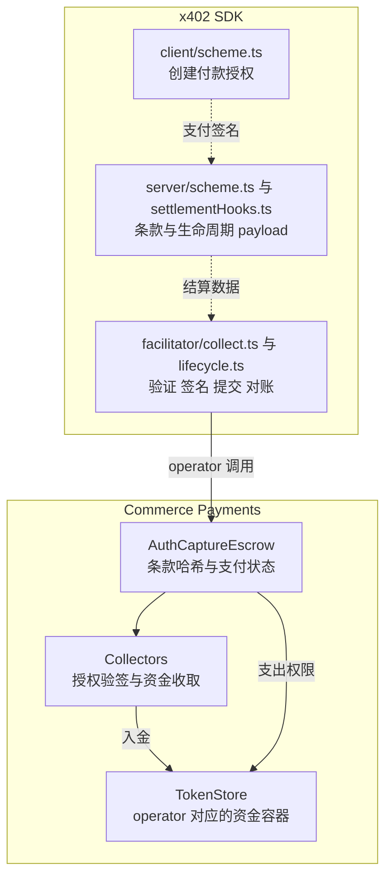

# 官方 auth-capture 代码走读

> 状态：未经评审的研究草稿。内容及移植判断尚未完成独立评审。

本次走读固定到 2026 年 10 月 17 日查询的官方 main：x402-foundation/x402 的 faa1c694c66a3732aaabbce93bdae140e521a67d（提交时间 2026 年 10 月 15 日 UTC）；base/commerce-payments 的 b748fdd7a830a655a19a530edcf2a94b9dc7d25f（2026 年 9 月 3 日 UTC）。SDK 以 TypeScript 为主，合约以 Commerce Payments v1.1 实现为主；main 源码能力不等于 npm 已发布版本能力。

阅读目标是能回答：签名承诺了什么、谁可以推动支付、钱在哪里、每个函数改变什么，以及失败时哪些事情不会发生。本文是静态源码走读，检查了相关测试源码，未执行 SDK 测试、Foundry 测试或链上交易。

## 1 官方实现分为两层

x402 SDK 负责付款条件、签名、商户操作授权、验证、交易提交和本地记录；Commerce Payments 负责链上账本及代币移动。商户交付状态不在基础 Escrow 的判断范围内。



这里表示代码职责与调用关系，不是钱包操作步骤。SDK 中 client、server、facilitator 都有名为 AuthCaptureEvmScheme 的类，它们实现不同接口，导入入口不能混用。

## 2 先读合约的数据模型

源码：[struct PaymentInfo](https://github.com/base/commerce-payments/blob/b748fdd7a830a655a19a530edcf2a94b9dc7d25f/src/AuthCaptureEscrow.sol#L27)；[struct PaymentState](https://github.com/base/commerce-payments/blob/b748fdd7a830a655a19a530edcf2a94b9dc7d25f/src/AuthCaptureEscrow.sol#L55)。

PaymentInfo 是整笔支付的固定条款：

| 字段组 | 内容 | 为什么参与支付身份 |
| --- | --- | --- |
| 权限 | operator、payer | 限制操作人和到期取回人 |
| 收款 | receiver、token、maxAmount | 固定资金去向、币种和收款上限 |
| 时间 | preApprovalExpiry、authorizationExpiry、refundExpiry | 区分收款、扣款、退款三个窗口 |
| 费用 | minFeeBps、maxFeeBps、feeReceiver | 限制费用范围与费用地址 |
| 唯一性 | salt | 区分重复购买，并承载协议的地址绑定承诺 |

PaymentInfo 不是一个可原地修改的订单对象。每次函数都重新 getHash(paymentInfo)，再查 paymentState[hash]；改一项便换了支付身份，无法取出原支付余额。

PaymentState 的三个字段必须区分：

```solidity
struct PaymentState {
    bool hasCollectedPayment;
    uint120 capturableAmount;
    uint120 refundableAmount;
}
```

hasCollectedPayment 是永久的单次收款标记。capturableAmount 是还在托管里的可扣金额。refundableAmount 是已经扣过、尚允许退的额度，不表示合约另外存了一笔退款准备金。

设 A 为首次收款、C 为累计 capture、V 为 void/reclaim 返回金额、R 为累计 refund，则 escrow 路径的账本关系为：

```text
capturableAmount = A - C - V
refundableAmount = C - R
A <= maxAmount
```

charge 是直接令 C=A 的路径。refund 不恢复 capturableAmount，void/reclaim 不清除已产生的 refundableAmount。

## 3 支付哈希如何从客户端对应到合约

源码：SDK [function hashPaymentInfo(](https://github.com/x402-foundation/x402/blob/faa1c694c66a3732aaabbce93bdae140e521a67d/typescript/packages/mechanisms/evm/src/auth-capture/nonce.ts#L45)，合约 [function getHash(](https://github.com/base/commerce-payments/blob/b748fdd7a830a655a19a530edcf2a94b9dc7d25f/src/AuthCaptureEscrow.sol#L383)，Collector [function _getHashPayerAgnostic(](https://github.com/base/commerce-payments/blob/b748fdd7a830a655a19a530edcf2a94b9dc7d25f/src/collectors/TokenCollector.sol#L70)。

```text
H(info) = keccak256(abi.encode(
  chainId,
  escrowAddress,
  keccak256(abi.encode(PAYMENT_INFO_TYPEHASH, info))
))

paymentInfoHash = H(真实 payer 的 PaymentInfo)
signatureNonce  = H(payer 置零后的 PaymentInfo)
```

客户端 hashPaymentInfo 使用 encodeAbiParameters；合约 getHash 使用 abi.encode。字段类型、顺序、typehash 和外层 chainId、escrow 地址必须一致。这里是自定义支付标识的哈希规则，不能直接替换成带 0x1901 前缀的通用 EIP-712 digest。

为什么 token nonce 中没有真实 payer？实际付款人仍由 ERC-3009 的 from 或 Permit2 的 owner 及其签名绑定；Collector 将传入 PaymentInfo 的 payer 置零后重算 nonce。两份签名可共享某个 nonce 值不代表签名可跨付款人使用。随机 salt 负责每次付款的新鲜性。

最关键的绑定是：receiver、operator、金额上限、期限、费用都进入 nonce。只拿到 token 签名的人不能修改这些字段后仍通过 canonical Collector 的授权验证。

## 4 客户端到底签了什么

入口：[async createPaymentPayload(](https://github.com/x402-foundation/x402/blob/faa1c694c66a3732aaabbce93bdae140e521a67d/typescript/packages/mechanisms/evm/src/auth-capture/client/scheme.ts#L61)；地址承诺：[export function deriveBoundSalt(](https://github.com/x402-foundation/x402/blob/faa1c694c66a3732aaabbce93bdae140e521a67d/typescript/packages/mechanisms/evm/src/auth-capture/nonce.ts#L381)。

createPaymentPayload 校验协议版本与必填 extra，解析网络和部署，再把 requirements 转成 Solidity 字段名称的 PaymentInfo。preApprovalExpiry 从当前时间加 maxTimeoutSeconds 得出；facilitator 后续重建时从签名中的 validBefore/deadline 读取，不能重新取当前时间计算。

客户端生成随机 saltNonce。receiverAuthorizer 或 policy 非零时，salt 是带 SALT_BINDING_TYPEHASH 的地址承诺；否则 salt 就是随机值，不附加 saltNonce。绑定启用时两者都要保留：salt 进入链上条款，saltNonce 用来验证承诺。

| 签名路径 | EIP-712 domain | 签名的收款授权 |
| --- | --- | --- |
| ERC-3009 | token 合约，name/version 来自 token 域参数 | ReceiveWithAuthorization，to 为匹配部署的 ERC3009 Collector |
| Permit2 | canonical Permit2 合约 | PermitTransferFrom，spender 为匹配部署的 Permit2 Collector |

此处一次付款签名只同意收款条款，不代表买方又签了每次 capture。后续扣款靠 operator 权限执行；费用和时间等仍受条款限制。

## 5 合约收款先看 authorize

源码：[function authorize(](https://github.com/base/commerce-payments/blob/b748fdd7a830a655a19a530edcf2a94b9dc7d25f/src/AuthCaptureEscrow.sol#L236)；通用校验：[function _validatePayment(](https://github.com/base/commerce-payments/blob/b748fdd7a830a655a19a530edcf2a94b9dc7d25f/src/AuthCaptureEscrow.sol#L478)；实收入金：[function _collectTokens(](https://github.com/base/commerce-payments/blob/b748fdd7a830a655a19a530edcf2a94b9dc7d25f/src/AuthCaptureEscrow.sol#L408)。

authorize 的函数体可以分为三段，而非仅把名字理解为链下“授权”：

| 段落 | 实际行为 | 资金意义 |
| --- | --- | --- |
| 入口与校验 | onlySender(operator)、validAmount、_validatePayment | 仅 operator 可调用，金额大于零、不超 uint120 与 maxAmount，期限合法 |
| 写账 | 检查未收款，设 true、capturable=amount、refundable=0 | 同一支付只能收款一次 |
| 收款 | Payment Collector 拉取代币，检查 TokenStore 净增 amount | 成功时资金已经离开 payer |

_validatePayment 检查 now < preApprovalExpiry，且 preApprovalExpiry ≤ authorizationExpiry ≤ refundExpiry，minFeeBps ≤ maxFeeBps ≤ 10000。写账发生在外部收款前，但后续任何调用 revert，前面写入与事件也一起回滚。

合约允许 amount 小于 maxAmount；x402 authorize 则收完整签名上限。否则这笔单次授权已消耗，剩余额度不能再次补充。文档必须区分“合约允许”和“协议选择”。

## 6 Collector 才是 token 签名的执行入口

源码：[function _collectTokens(](https://github.com/base/commerce-payments/blob/b748fdd7a830a655a19a530edcf2a94b9dc7d25f/src/collectors/ERC3009PaymentCollector.sol#L31)；[function _collectTokens(](https://github.com/base/commerce-payments/blob/b748fdd7a830a655a19a530edcf2a94b9dc7d25f/src/collectors/Permit2PaymentCollector.sol#L37)；[function _getHashPayerAgnostic(](https://github.com/base/commerce-payments/blob/b748fdd7a830a655a19a530edcf2a94b9dc7d25f/src/collectors/TokenCollector.sol#L70)。

ERC3009PaymentCollector 调 token.receiveWithAuthorization，value 使用 PaymentInfo.maxAmount，nonce 使用 payer-agnostic hash。若实际 amount 较小，先退 maxAmount-amount 给 payer，再把 amount 转入 TokenStore。因此小额 charge 也可能需要钱包暂时具备完整上限的余额。

Permit2PaymentCollector 的 permitted.amount 是上限，requestedAmount 是本次 amount，to 直接是 TokenStore。它要求 token 已给 Permit2 相应 allowance；不能把“只签一次付款授权”解释为从未使用过的 token 无需链上 approve。

TokenCollector.collectTokens 仅接受其配置的 Escrow 调用。Escrow 自己还会检查 CollectorType 与操作匹配，并要求 TokenStore 的 balanceAfter 恰好为 balanceBefore+amount。这阻止无足额入金的账本增加，但不是 canonical 地址白名单；固定部署地址和配套 Collector 的校验还发生在 SDK。

## 7 capture 的核心是余额转换与分账

源码：[function capture(](https://github.com/base/commerce-payments/blob/b748fdd7a830a655a19a530edcf2a94b9dc7d25f/src/AuthCaptureEscrow.sol#L267)；费用校验：[function _validateFee(](https://github.com/base/commerce-payments/blob/b748fdd7a830a655a19a530edcf2a94b9dc7d25f/src/AuthCaptureEscrow.sol#L511)；分账：[function _distributeTokens(](https://github.com/base/commerce-payments/blob/b748fdd7a830a655a19a530edcf2a94b9dc7d25f/src/AuthCaptureEscrow.sol#L464)。

capture 没有 Collector 参数，因为它不再次向 payer 收款。它检查调用者、金额、费用、扣款期限，以及 capturableAmount ≥ amount。

```solidity
state.capturableAmount -= uint120(amount);
state.refundableAmount += uint120(amount);
paymentState[paymentInfoHash] = state;
```

然后从 TokenStore 将 feeAmount 发给费用方，将 amount-feeAmount 发给 receiver。amount 包含手续费，不是在 amount 之外额外扣一次。扣款 6 USDC、费用 0.06 时，商户收到 5.94。

v1.1 的 feeAmount 为代币最小单位，且须处于 floor(amount×minFeeBps/10000) 与 floor(amount×maxFeeBps/10000) 之间。条款 feeReceiver 非零则不能更换；费用非零时执行费用地址不得为零。逐笔整数向下取整意味着多次小额 capture 的费用与一次 capture 可能不同。

capture 可多次执行，但累计不能越过托管额；到达 authorizationExpiry 的那一刻即不能再扣。refund 不会重新增加可扣余额。

## 8 charge 的原子性仅覆盖本次收款和分账

源码：[function charge(](https://github.com/base/commerce-payments/blob/b748fdd7a830a655a19a530edcf2a94b9dc7d25f/src/AuthCaptureEscrow.sol#L200)。

charge 执行收款检查和费用检查，直接设 capturable=0、refundable=amount，随后收款并分账。任一 token 操作失败，整笔交易回滚。

它与 authorize 后再 capture 的经济效果类似，但没有持续的托管阶段，也没有可供 reclaim 的余额。其原子性不覆盖外部 HTTP 服务交付，更不覆盖以后的一笔 refund。

## 9 void reclaim refund 必须分别理解

源码：[function void(](https://github.com/base/commerce-payments/blob/b748fdd7a830a655a19a530edcf2a94b9dc7d25f/src/AuthCaptureEscrow.sol#L304)；[function reclaim(](https://github.com/base/commerce-payments/blob/b748fdd7a830a655a19a530edcf2a94b9dc7d25f/src/AuthCaptureEscrow.sol#L323)；[function refund(](https://github.com/base/commerce-payments/blob/b748fdd7a830a655a19a530edcf2a94b9dc7d25f/src/AuthCaptureEscrow.sol#L351)；[function _collectTokens(](https://github.com/base/commerce-payments/blob/b748fdd7a830a655a19a530edcf2a94b9dc7d25f/src/collectors/OperatorRefundCollector.sol#L28)。

| 函数 | 谁调用 | 条件 | 使用哪笔钱 |
| --- | --- | --- | --- |
| void | operator | capturable>0，函数本身无独立时间限制 | 退回剩余托管 |
| reclaim | payer | now≥authorizationExpiry，capturable>0 | 退回剩余托管 |
| refund | operator | now<refundExpiry，amount≤refundable | Collector 新收退款资金，再付给 payer |

void 和 reclaim 不接收部分金额参数，都会清空整笔剩余 capturableAmount；已扣部分仍保留退款额度。void 不能取消一个尚未 authorize 的付款签名：链上可扣余额为零时它会失败。

reclaim 的唯一调用者是 payer，到期不会自动触发。智能账户必须经其自身执行，确保 Escrow 看到的 msg.sender 是 payer。

refund 先扣减退款额度，再通过 Refund Collector 入金并向买方转账；收款失败则全量回滚。标准 OperatorRefundCollector 从 operator transferFrom，需要余额和 allowance。它不向商户或费用方追回此前收到的资金。

## 10 TokenStore 为何是每个 operator 一个

源码：[function sendTokens(](https://github.com/base/commerce-payments/blob/b748fdd7a830a655a19a530edcf2a94b9dc7d25f/src/TokenStore.sol#L33)；[function _sendTokens(](https://github.com/base/commerce-payments/blob/b748fdd7a830a655a19a530edcf2a94b9dc7d25f/src/AuthCaptureEscrow.sol#L433)。

getTokenStore 使用 Escrow 的 tokenStoreImplementation、operator 派生的 salt 和部署者地址预测 clone 地址。代币可先进入这个未部署的确定地址；_sendTokens 在首次支出时发现没有代码，部署 clone 并重试。

TokenStore.sendTokens 只接受固定 Escrow 调用。它不自己理解每笔订单，由 Escrow 用 paymentInfoHash 的余额约束支出。同一 operator 的资金物理上汇总，支付权限和金额在 Escrow 逻辑上隔离。

nonReentrant、外部调用前更新账本、转账失败回滚共同约束重入与中间状态。当前实现使用 transient storage 重入锁，目标链必须支持对应 EVM 能力。

## 11 回到 SDK 看谁把合法参数送进合约

源码：[async enhancePaymentRequirements(](https://github.com/x402-foundation/x402/blob/faa1c694c66a3732aaabbce93bdae140e521a67d/typescript/packages/mechanisms/evm/src/auth-capture/server/scheme.ts#L228)；[async enrichSettlementPayload(](https://github.com/x402-foundation/x402/blob/faa1c694c66a3732aaabbce93bdae140e521a67d/typescript/packages/mechanisms/evm/src/auth-capture/server/settlementHooks.ts#L80)；[private async persistCollect(](https://github.com/x402-foundation/x402/blob/faa1c694c66a3732aaabbce93bdae140e521a67d/typescript/packages/mechanisms/evm/src/auth-capture/server/settlementHooks.ts#L255)。

server.enhancePaymentRequirements 合并 facilitator 与商户配置，并解析部署、期限和支付路径；它明确拒绝旧 autoCapture 字段。相对期限会转换为绝对期限，不能在后续扣款时改用新期限重建订单。

settlementHooks 的 before-handler 不追加商户扣款签名；authorize 成功后的 handleAfterSettle 保存完整 PaymentInfo、saltNonce、支付 key、收款交易和余额。after-handler 为 sync escrow 构造 capture，为 authorization 路径补齐 charge；deferred escrow 跳过请求结束时扣款，保留已托管结果。cancel 对可代办生命周期的 escrow 路径构造 void。

这些是 SDK 的职责，不能归为合约自带的“自动扣款”或“服务失败自动退款”。本文未展开 core HTTP middleware 的调度源码，阶段解释依据此处 hooks 的分支及对应测试。

## 12 facilitator 验证的不只是付款签名

分派：[async verify(](https://github.com/x402-foundation/x402/blob/faa1c694c66a3732aaabbce93bdae140e521a67d/typescript/packages/mechanisms/evm/src/auth-capture/facilitator/scheme.ts#L169)；collect 验证：[export async function verifyCollect(](https://github.com/x402-foundation/x402/blob/faa1c694c66a3732aaabbce93bdae140e521a67d/typescript/packages/mechanisms/evm/src/auth-capture/facilitator/collect.ts#L177)；目标选择：[export function resolveSettleTarget](https://github.com/x402-foundation/x402/blob/faa1c694c66a3732aaabbce93bdae140e521a67d/typescript/packages/mechanisms/evm/src/auth-capture/extra.ts#L329)；operator 准入：[export function validateOperator](https://github.com/x402-foundation/x402/blob/faa1c694c66a3732aaabbce93bdae140e521a67d/typescript/packages/mechanisms/evm/src/auth-capture/extra.ts#L261)。

verify/settle 按 payload.type 区分 collect 与 capture/void/refund。verifyCollect 主要检查：

- scheme、network、extra、operator 与收款方式匹配。
- deadline 次序和剩余有效期；实现预留 6 秒安全余量。
- ERC-3009 to 或 Permit2 spender 与所选部署 Collector 一致。
- 付款签名、金额上限、重建 PaymentInfo 后的 nonce。
- 启用绑定时的 saltNonce 与 salt；charge completion 的金额、费用与商户授权。
- 模拟实际调用是否成功。

智能钱包不是简单 recoverAddress：ERC-1271 失败不能自动回退为 ECDSA 成功；未部署的 ERC-6492 钱包依赖允许的准备目标和 collect 模拟完成验证。预验证可解开内层签名，但提交必须保留 ERC-6492 wrapper 以便链上完成部署准备。

delegated 的 operator 必须为 facilitator 控制的提交地址，调用目标是 Escrow。custom 调用目标是 operator 合约，生命周期不由此 SDK relay。policy 类型在这份实现中仍不作为可用 operator 接受。

## 13 custom operator 不能只凭调用不 revert 判断成功

源码：[async function simulateCollect(](https://github.com/x402-foundation/x402/blob/faa1c694c66a3732aaabbce93bdae140e521a67d/typescript/packages/mechanisms/evm/src/auth-capture/facilitator/collect.ts#L1093)；[export async function settleCollect(](https://github.com/x402-foundation/x402/blob/faa1c694c66a3732aaabbce93bdae140e521a67d/typescript/packages/mechanisms/evm/src/auth-capture/facilitator/collect.ts#L765)。

custom operator 可以是一个收到调用却什么都没做的合约。simulateCollect 因此要求 simulateCalls，批量观察调用前后状态，并检查 Escrow 事件、paymentState 和余额变化，还对 operator 调用设置 gas 上限。

实际广播后的 awaitCollectSettlement 也会核对所需事件和状态；custom 路径额外核对余额。正确目标是“完成约定的收款”，而非仅“交易 receipt 为 success”。

这是 SDK 验证外围合约行为的措施，不表示任意自定义仲裁逻辑已被基础 Escrow 证明正确。

## 14 商户操作签名与预期余额在哪里检查

源码：[export async function buildCaptureFields](https://github.com/x402-foundation/x402/blob/faa1c694c66a3732aaabbce93bdae140e521a67d/typescript/packages/mechanisms/evm/src/auth-capture/lifecyclePayload.ts#L100)；[async function verifyCapturePayload(](https://github.com/x402-foundation/x402/blob/faa1c694c66a3732aaabbce93bdae140e521a67d/typescript/packages/mechanisms/evm/src/auth-capture/facilitator/lifecycle.ts#L864)；[async function signDelegatedLifecycle(](https://github.com/x402-foundation/x402/blob/faa1c694c66a3732aaabbce93bdae140e521a67d/typescript/packages/mechanisms/evm/src/auth-capture/facilitator/lifecycle.ts#L258)；[export async function bindThenBroadcast](https://github.com/x402-foundation/x402/blob/faa1c694c66a3732aaabbce93bdae140e521a67d/typescript/packages/mechanisms/evm/src/auth-capture/facilitator/delegatedAuth.ts#L198)。

buildCaptureFields 将支付 key、金额、费用、预期 capturable/refundable 余额纳入商户操作签名。verifyCapturePayload 验证签名、读取链上余额并与预期值比对，再模拟 capture。余额变化后，旧操作通常无法再次通过同一预期状态检查。

但基础 Escrow.capture 的参数没有 authorizerSignature，也没有 expectedBalances。它只认 operator、金额、费用和期限。因此这里的商户同意与单次执行检查主要是 facilitator 层的规则；读链与写链之间仍存在并发时间窗口，不能写成链上原子比较交换。

当前源码还支持 facilitator 代任 receiver authorizer。这个分支不能因为没有商户签名就直接放行：先 resolveCallerIdentity，在收款时 bind 调用者与支付身份；后续生命周期必须匹配同一绑定身份才能由 facilitator 生成操作签名。bindThenBroadcast 在广播前建立绑定，是否撤销绑定要依据广播结果；结果不明时不能假设交易从未发生。

## 15 pending 重试和剩余款释放的实际边界

源码：[export async function settleCollect(](https://github.com/x402-foundation/x402/blob/faa1c694c66a3732aaabbce93bdae140e521a67d/typescript/packages/mechanisms/evm/src/auth-capture/facilitator/collect.ts#L765)；[async function settleVerifiedLifecycle(](https://github.com/x402-foundation/x402/blob/faa1c694c66a3732aaabbce93bdae140e521a67d/typescript/packages/mechanisms/evm/src/auth-capture/facilitator/lifecycle.ts#L582)；[async capture(](https://github.com/x402-foundation/x402/blob/faa1c694c66a3732aaabbce93bdae140e521a67d/typescript/packages/mechanisms/evm/src/auth-capture/server/lifecycleManager.ts#L43)；[export interface AuthorizedPaymentStorage](https://github.com/x402-foundation/x402/blob/faa1c694c66a3732aaabbce93bdae140e521a67d/typescript/packages/mechanisms/evm/src/auth-capture/server/storage.ts#L64)。

settleCollect 先检查 pending 交易；缓存命中时对原交易等待与对账，避免直接重广播。collect key 是付款签名。生命周期签名由 facilitator 动态生成时，pending key 按操作内容派生，避免同样操作重签后落到不同 key。pending 不是已确认失败，不能盲目生成新 salt 重新付款。

capture 带剩余款释放意图时，settleVerifiedLifecycle 先等 capture 成功，再单独 submit void。代码明确按 best effort 处理第二笔操作。capture 成功后 void 失败，仍返回 capture 成功，剩余款仍需后续 void 或到期 reclaim。

这里还有本地记录的限制：LifecycleManager.capture 成功后按 opts.voidRemainder 更新本地余额；sync hooks 也按 void 签名是否存在判断清零意图。因此不能把本地 capturable=0 当成第二笔 void 已确认的证明。应结合两笔交易及真实链上 paymentState 理解。这是源码可见的记录与执行差异，本文没有运行故障注入测试。

AuthorizedPaymentStorage.update 要求原子条件修改；默认内存实现的锁只覆盖一个 JS runtime，不能提供跨实例协调。存储原子更新也不等于整个“读记录—发链上交易—更新记录”区间被锁住。

## 16 官方测试怎样对应上述结论

测试代码存在不代表本次已经通过。以下列出本次阅读的具体测试入口，供复核和后续执行。

| 测试源码 | 可核对的断言 |
| --- | --- |
| [capture.t.sol](https://github.com/base/commerce-payments/blob/b748fdd7a830a655a19a530edcf2a94b9dc7d25f/test/src/PaymentEscrow/capture.t.sol) | 非 operator 拒绝、过期拒绝、部分及多次 capture、费用上下界 |
| [reclaim.t.sol](https://github.com/base/commerce-payments/blob/b748fdd7a830a655a19a530edcf2a94b9dc7d25f/test/src/PaymentEscrow/reclaim.t.sol) | 仅 payer、到期前拒绝、余额归零和重复取回拒绝 |
| [refund.t.sol](https://github.com/base/commerce-payments/blob/b748fdd7a830a655a19a530edcf2a94b9dc7d25f/test/src/PaymentEscrow/refund.t.sol) | 超额度和过期拒绝、operator 退款及事件 |
| [pendingSettlement.test.ts](https://github.com/x402-foundation/x402/blob/faa1c694c66a3732aaabbce93bdae140e521a67d/typescript/packages/mechanisms/evm/test/unit/auth-capture/pendingSettlement.test.ts) | receipt 超时返回 pending，缓存命中不重广播 |
| [settlementHooks.test.ts](https://github.com/x402-foundation/x402/blob/faa1c694c66a3732aaabbce93bdae140e521a67d/typescript/packages/mechanisms/evm/test/unit/auth-capture/settlementHooks.test.ts) | delegated 无签名 enrichment、deferred 跳过、失败不保存记录 |
| [lifecycleFacilitator.test.ts](https://github.com/x402-foundation/x402/blob/faa1c694c66a3732aaabbce93bdae140e521a67d/typescript/packages/mechanisms/evm/test/unit/auth-capture/lifecycleFacilitator.test.ts) | 拒绝 PaymentInfo 不匹配、salt 绑定错误、错误费用字段 |

## 17 阅读后应能明确的边界

合约层控制金额、费用、时间、操作人、账本变化和真实代币收付；SDK 层组织商户签名、身份绑定、custom 模拟和 pending 重试。资源是否交付、退款是否批准、退款由谁出资属于业务与 operator 规则。

最容易误读的四点是：authorize 已经收钱；refundable 是额度而非储备金；商户签名未由基础 Escrow 检查；capture 加 void 不是一笔原子交易。沿上面的固定代码链接可以分别找到这些结论的实现位置。

