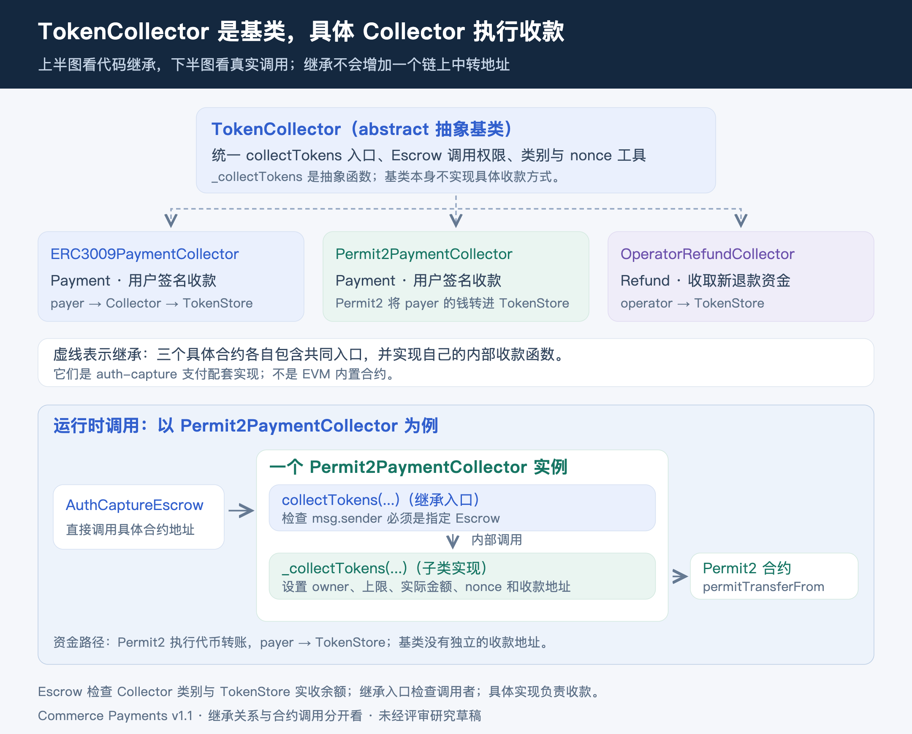
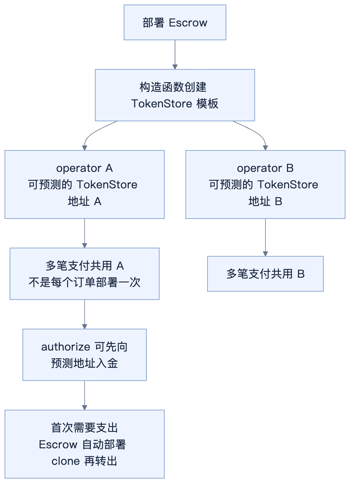

# auth-capture Solidity 合约源码走读

> 未经评审的研究草稿。静态阅读官方合约与测试源码，未执行 Foundry 测试或链上交易。

更新：2026 年 10 月 20 日。[总目录](../README.md) · [分享主稿](auth-capture-contract-analysis.md) · [基础概念](auth-capture-foundations.md) · [SDK 与接口](auth-capture-official-code-walkthrough.md) · [TRON 适配](auth-capture-tron-port.md)

本文按固定的 Commerce Payments v1.1 源码，解释检查条件、合约调用和账本变化。全文使用同一笔订单：上限 10 USDC、实际消费 6、费用 1%，传入真实参数时需乘 10⁶。代码摘录省略了部分声明和检查，流程块用于辅助阅读；源码版本和验证范围见[来源说明](auth-capture-foundations.md#6-源码版本与验证范围)。

## 1 合约分工与源码阅读顺序

Escrow 管订单账和权限，Collector 负责接入不同收款方式，TokenStore 持币并按 Escrow 指令转出。TokenCollector 是抽象基类，没有单独的收款中转地址。这些配套合约由 x402 复用；项目关系及“本次新增”的两种含义见[基础概念](auth-capture-foundations.md#4-支付配套合约与通用依赖)。

| 阅读顺序 | 官方源码 | 要回答的问题 |
| --- | --- | --- |
| 1 | [AuthCaptureEscrow.sol](https://github.com/base/commerce-payments/blob/b748fdd7a830a655a19a530edcf2a94b9dc7d25f/src/AuthCaptureEscrow.sol) | 如何识别订单，谁能收款、扣款、退款 |
| 2 | [TokenStore.sol](https://github.com/base/commerce-payments/blob/b748fdd7a830a655a19a530edcf2a94b9dc7d25f/src/TokenStore.sol) | 钱存在哪个地址，谁能指令转出 |
| 3 | [TokenCollector.sol](https://github.com/base/commerce-payments/blob/b748fdd7a830a655a19a530edcf2a94b9dc7d25f/src/collectors/TokenCollector.sol) | 收款入口权限和 nonce 如何统一 |
| 4 | [ERC3009PaymentCollector.sol](https://github.com/base/commerce-payments/blob/b748fdd7a830a655a19a530edcf2a94b9dc7d25f/src/collectors/ERC3009PaymentCollector.sol) | USDC 等支持 ERC-3009 的 token 怎样验签收款 |
| 5 | [Permit2PaymentCollector.sol](https://github.com/base/commerce-payments/blob/b748fdd7a830a655a19a530edcf2a94b9dc7d25f/src/collectors/Permit2PaymentCollector.sol) | 如何通过 Permit2 收款 |
| 6 | [OperatorRefundCollector.sol](https://github.com/base/commerce-payments/blob/b748fdd7a830a655a19a530edcf2a94b9dc7d25f/src/collectors/OperatorRefundCollector.sol) | 退款实际扣谁的钱 |
| 7 | [ERC6492SignatureHandler.sol](https://github.com/base/commerce-payments/blob/b748fdd7a830a655a19a530edcf2a94b9dc7d25f/src/collectors/ERC6492SignatureHandler.sol) | 未部署钱包的准备调用怎样处理 |

ERC6492SignatureHandler 是两个付款 Collector 共用的签名准备辅助类，后文单独说明。

## 2 PaymentInfo：用户同意的固定条款

位置：[PaymentInfo](https://github.com/base/commerce-payments/blob/b748fdd7a830a655a19a530edcf2a94b9dc7d25f/src/AuthCaptureEscrow.sol#L27)。

| 字段 | 代码里的作用 | 例子 |
| --- | --- | --- |
| operator | authorize、charge、capture、void、refund 的唯一调用者 | facilitator 的提交地址，也可以是自定义 operator 合约 |
| payer | 付款人、退款接收人、reclaim 的调用者 | 用户钱包 |
| receiver | 扣款后货款接收人 | 商家钱包 |
| token | 本订单代币合约 | USDC |
| maxAmount | 首次收款上限 | 10 USDC |
| preApprovalExpiry | authorize / charge 首次收款的截止时间 | 付款签名有效窗口 |
| authorizationExpiry | capture 截止、reclaim 开始时间 | 订单扣款窗口 |
| refundExpiry | refund 截止时间 | 售后退款窗口 |
| minFeeBps / maxFeeBps | 限制每次扣款的费用 | 都为 100 时固定 1% |
| feeReceiver | 非零时固定费用地址；为零时允许调用时选择 | 平台或 facilitator 的费用地址 |
| salt | 让相同商家、金额等条件的不同购买有不同身份 | 每笔购买独立生成 |

后续调用必须传入原始条款。合约没有修改订单收款人或延期的入口；一旦改动条款，支付哈希就会变化，也就无法操作原来的余额。

## 3 PaymentState：链上只存三项状态

位置：[PaymentState 与 paymentState](https://github.com/base/commerce-payments/blob/b748fdd7a830a655a19a530edcf2a94b9dc7d25f/src/AuthCaptureEscrow.sol#L55)。

```solidity
struct PaymentState {
    bool hasCollectedPayment;
    uint120 capturableAmount;
    uint120 refundableAmount;
}
```

- `hasCollectedPayment`：这笔支付是否已经收过钱。authorize 或 charge 后为 true，退完钱也不复位。
- `capturableAmount`：这笔订单还有多少托管款可以付给商家。
- `refundableAmount`：已经付出去的金额中，还允许退多少。它是额度，不是另存的准备金。

账本按 `paymentState[paymentInfoHash]` 存储。完整条款由调用者提供，合约重算哈希后定位三项状态。

设 A 为首次入金、C 为累计 capture、V 为 void / reclaim 返回金额、R 为累计 refund，escrow 路径满足：

```text
capturableAmount = A - C - V
refundableAmount = C - R
A <= maxAmount
```

charge 相当于收款时直接令 C=A。refund 不恢复可扣余额，void / reclaim 不清除已经产生的可退额度。

## 4 getHash：订单编号怎样绑定条款

位置：[getHash](https://github.com/base/commerce-payments/blob/b748fdd7a830a655a19a530edcf2a94b9dc7d25f/src/AuthCaptureEscrow.sol#L383)。

```solidity
bytes32 paymentInfoHash = keccak256(abi.encode(PAYMENT_INFO_TYPEHASH, paymentInfo));
return keccak256(abi.encode(block.chainid, address(this), paymentInfoHash));
```

第一步把全部条款编码成哈希，第二步再加入当前链和 Escrow 地址。所以同样条款换一条链、换一个 Escrow，也会得到不同支付编号。

哈希按上面的 `abi.encode` 规则计算，并没有直接调用通用 EIP-712 digest 函数。SDK 必须使用相同的字段顺序、类型和外层编码。

canonical Collector 会把 PaymentInfo 的 payer 临时置零，调用 getHash，再把结果作为 ERC-3009 / Permit2 的 nonce。这样，付款签名就绑定了订单条款。真实付款人仍由 token 签名中的 from / owner 绑定；修改 operator、receiver、费用或期限后，nonce 也会变化，原签名便无法继续使用。

这里有两个不同的哈希：**订单账本哈希带真实 payer，付款签名的 nonce 使用 payer 置零后的哈希。**

## 5 入口修饰器：谁能做、金额是否合法

位置：[onlySender / validAmount](https://github.com/base/commerce-payments/blob/b748fdd7a830a655a19a530edcf2a94b9dc7d25f/src/AuthCaptureEscrow.sol#L170)。

`onlySender(paymentInfo.operator)` 要求当前调用者就是原 operator；reclaim 则使用 payer。`validAmount(amount)` 要求金额大于零、不超过 uint120 上限，后面转成 uint120 才不会截断。

六个资金操作都有 `nonReentrant`。它们先检查、更新订单状态，再调用外部代币合约。外部调用失败，前面的账本修改和事件也会回滚。当前实现使用 transient storage 重入锁，移植时需要核对目标链能否执行相关指令。

基础 Escrow 不检查业务是否交付，也没有接收商家的 `authorizerSignature` 参数。默认 delegated 模式中，商家的操作授权由 facilitator 校验；合约只按 operator 和固定条款执行。

## 6 authorize：先写账，再验证钱真的到账

位置：[authorize](https://github.com/base/commerce-payments/blob/b748fdd7a830a655a19a530edcf2a94b9dc7d25f/src/AuthCaptureEscrow.sol#L236)。按执行顺序看：

| 顺序 | 代码动作 | 白话解释 |
| --- | --- | --- |
| 1 | onlySender、validAmount、_validatePayment | 调用者正确、金额正确、还在首次收款窗口内 |
| 2 | getHash；检查 hasCollectedPayment | 找到这笔订单，禁止第二次收款 |
| 3 | 写 true、capturable=amount、refundable=0 | 建立托管账本，尚未向商家付款 |
| 4 | _collectTokens(..., CollectorType.Payment) | 通过付款 Collector 收入足额代币 |

[_validatePayment](https://github.com/base/commerce-payments/blob/b748fdd7a830a655a19a530edcf2a94b9dc7d25f/src/AuthCaptureEscrow.sol#L478) 还要求 amount≤maxAmount、preApprovalExpiry≤authorizationExpiry≤refundExpiry，以及 minFeeBps≤maxFeeBps≤10000。它检查的是现在是否早于 preApprovalExpiry，而不只是三个期限的顺序。

例子成功后：hasCollected=true，capturable=10，refundable=0，10 USDC 已进入 operator 对应的 TokenStore。

合约允许 authorize 金额小于上限；本次阅读的 x402 authorize 路径选择收完整上限。无论收多少，这个支付身份都不能再用来补款。

## 7 Escrow._collectTokens：安排收款并核对入金

位置：[_collectTokens](https://github.com/base/commerce-payments/blob/b748fdd7a830a655a19a530edcf2a94b9dc7d25f/src/AuthCaptureEscrow.sol#L408)。

```text
检查 collectorType 是本次要求的 Payment 或 Refund
→ 找到本 operator 的 TokenStore
→ 读取 TokenStore 的 token 余额 before
→ 调 Collector.collectTokens(...)
→ 读取余额 after
→ 要求 after == before + amount
```

Collector 返回成功后，Escrow 还要检查实际余额净增是否等于 amount。少到账、多到账都会被拒绝，因此也不能假定带转账扣费的 token 可以兼容。

这一步检查的是 Collector 类型和实际到账金额，没有硬编码 canonical Collector 的地址白名单。x402 SDK 还会按部署配置选择并验证相应 Collector。

## 8 TokenCollector 与具体 Collector：先看继承，再看收款

**TokenCollector 是抽象基类，提供共同入口和规则；具体 Collector 继承它，实现各自的收款方式。** 它不会先收钱再转发给其他 Collector，也不单独部署成一个中间收款地址。



### 8.1 TokenCollector 负责共同规则

位置：[TokenCollector.collectTokens](https://github.com/base/commerce-payments/blob/b748fdd7a830a655a19a530edcf2a94b9dc7d25f/src/collectors/TokenCollector.sol#L39)、[_getHashPayerAgnostic](https://github.com/base/commerce-payments/blob/b748fdd7a830a655a19a530edcf2a94b9dc7d25f/src/collectors/TokenCollector.sol#L70)。

| 基类提供的内容 | 作用 |
| --- | --- |
| authCaptureEscrow | 构造时固定允许调用自己的 Escrow |
| collectTokens(...) | 对外统一入口，检查调用者是指定 Escrow，再调用内部实现 |
| CollectorType | 声明 Payment / Refund 两种收款类别；具体合约返回相应类别 |
| _getHashPayerAgnostic(...) | 为付款授权计算绑定订单条款的 nonce，退款路径无需使用它 |
| _collectTokens(...) | internal virtual 抽象函数，留给具体 Collector 实现 |

共同入口的源码是：

```solidity
function collectTokens(
    AuthCaptureEscrow.PaymentInfo calldata paymentInfo,
    address tokenStore,
    uint256 amount,
    bytes calldata collectorData
) external {
    if (msg.sender != address(authCaptureEscrow)) revert OnlyAuthCaptureEscrow();
    _collectTokens(paymentInfo, tokenStore, amount, collectorData);
}
```

具体 Collector 部署后，继承的入口和子类实现都在同一个实例里执行。最后一行调用子类覆盖的内部函数，不会再向独立的 TokenCollector 地址发起外部调用。

同名函数要分清：

| 函数所在位置 | 做什么 |
| --- | --- |
| Escrow._collectTokens | 选定收款目标、检查 Collector 类型、核对 TokenStore 实收入金 |
| 具体 Collector 继承的 collectTokens | 检查必须由指定 Escrow 调用，进入自己的内部收款实现 |
| 具体 Collector 实现的 _collectTokens | 执行 ERC-3009、Permit2 或退款 transferFrom |

### 8.2 具体 Collector 决定从谁那里、用什么方式收款

| 合约 | 资金提供方 | 实际收款方式 | collectorType |
| --- | --- | --- | --- |
| ERC3009PaymentCollector | payer | token.receiveWithAuthorization，退差额后转入 TokenStore | Payment |
| Permit2PaymentCollector | payer | Permit2.permitTransferFrom，直接转入 TokenStore | Payment |
| OperatorRefundCollector | operator | token.transferFrom，依赖 operator 给退款 Collector 的 allowance | Refund |

Collector 负责把外部资金收进 TokenStore，但资金不一定先到 Collector 自己的地址。ERC-3009 会经过 Collector；Permit2 和标准退款则直接转入 TokenStore。

capture / void / reclaim 只需将已有托管款转出，调用顺序是 Escrow → TokenStore → token.transfer，无需 Collector。refund 要另收退款资金，先调用退款 Collector；charge 要当场收款，先调用付款 Collector。

### 8.3 ERC-3009：签名金额固定为上限

位置：[ERC3009PaymentCollector._collectTokens](https://github.com/base/commerce-payments/blob/b748fdd7a830a655a19a530edcf2a94b9dc7d25f/src/collectors/ERC3009PaymentCollector.sol#L31)。

```text
Operator → Escrow.authorize / charge
→ ERC3009PaymentCollector.collectTokens
→ token.receiveWithAuthorization：payer → Collector，金额 maxAmount
→ 如果 maxAmount > amount，Collector 将差额转回 payer
→ Collector 将本次 amount 转给 TokenStore
```

其中 to 是 Collector 自身，validBefore 是 preApprovalExpiry，nonce 是 payer 置零后的订单哈希，collectorData 提供付款签名。真正执行 token 授权验证的是 token 合约；Escrow 不自行恢复用户签名地址。

authorize 10 时，Collector 收 10、存 10；charge 6 时，Collector 收 10、退 4、存 6，全部在同一交易。因此后者虽然净付 6，执行时钱包仍需有 10。

### 8.4 Permit2：签上限，只请求本次金额

位置：[Permit2PaymentCollector._collectTokens](https://github.com/base/commerce-payments/blob/b748fdd7a830a655a19a530edcf2a94b9dc7d25f/src/collectors/Permit2PaymentCollector.sol#L37)。

```text
Operator → Escrow.authorize / charge
→ Permit2PaymentCollector.collectTokens
→ Permit2.permitTransferFrom
→ token.transferFrom：payer → TokenStore，金额 requestedAmount
```

permitted.amount 是 maxAmount，requestedAmount 是本次实际收取的 amount，nonce 和 deadline 同样绑定订单。签名中的 spender 是付款 Collector，但 token 的底层 ERC-20 allowance 要给 Permit2。两项授权都需要，不能只准备签名。

这两条路径使用同一套 TokenCollector 入口规则，不同点在各自的内部 _collectTokens。OperatorRefundCollector 的收款实现见第 13 节。

## 9 capture：把可扣余额转换为可退额度

位置：[capture](https://github.com/base/commerce-payments/blob/b748fdd7a830a655a19a530edcf2a94b9dc7d25f/src/AuthCaptureEscrow.sol#L267)。

检查顺序是：入口权限和金额 → _validateFee → now<authorizationExpiry → capturableAmount≥amount。随后执行：

```solidity
state.capturableAmount -= uint120(amount);
state.refundableAmount += uint120(amount);
paymentState[paymentInfoHash] = state;
```

例子 capture(6) 后，可扣余额 10→4，可退额度 0→6。这里并没有再从 payer 收钱，因此没有 Collector 参数。


[_distributeTokens](https://github.com/base/commerce-payments/blob/b748fdd7a830a655a19a530edcf2a94b9dc7d25f/src/AuthCaptureEscrow.sol#L464) 先转 feeAmount 给 feeReceiver，再转 amount−feeAmount 给 receiver。amount 包含费用；6 USDC、1% 费用时对应 0.06 和 5.94。

调用内部函数 _distributeTokens / _sendTokens 时，msg.sender 仍是 operator。Escrow 调用 TokenStore.sendTokens 后，TokenStore 看到的 msg.sender 是 Escrow；TokenStore 再调用 token.transfer，token 看到的 msg.sender 才是 TokenStore。

| 当前执行位置 | msg.sender | 用它检查什么 |
| --- | --- | --- |
| Escrow.capture 及其内部函数 | operator | 是否有权操作本订单；选哪个 TokenStore |
| TokenStore.sendTokens | Escrow | 是否为固定的支出指令来源 |
| token.transfer | TokenStore | 减少哪个地址的代币余额 |

两次转账依次执行，但在同一笔交易里一起成功或失败。如果后面的商家转账失败，前面的费用转账、账本修改和本次事件都会回滚。capture 可以分多次执行，但累计不能超过剩余托管额。

## 10 _validateFee：绝对金额受费率范围约束

位置：[_validateFee](https://github.com/base/commerce-payments/blob/b748fdd7a830a655a19a530edcf2a94b9dc7d25f/src/AuthCaptureEscrow.sol#L511)。

```text
minFee = floor(amount × minFeeBps / 10000)
maxFee = floor(amount × maxFeeBps / 10000)
要求 minFee ≤ feeAmount ≤ maxFee
```

v1.1 要求调用者传入绝对金额 feeAmount，不会在 capture 内自动选择费率。假设原条款的费率上下限都为 100，本次总额为 6，那么费用只能是 0.06。费用非零时，接收地址不能为零；条款中的 feeReceiver 非零时，调用传入的费用地址必须与它相同。

费用为零会跳过费用转账。没有额外写死的协议费；gas 由交易发送者或代付方另付。整数取整也意味着分多次小额扣款的费用不一定等于一次扣款的费用。

## 11 charge：收钱和分账合并在一个入口

位置：[charge](https://github.com/base/commerce-payments/blob/b748fdd7a830a655a19a530edcf2a94b9dc7d25f/src/AuthCaptureEscrow.sol#L200)。

按源码执行顺序：

```text
检查调用者、金额、_validatePayment 和 _validateFee
→ 拒绝 hasCollectedPayment=true
→ 写入 hasCollected=true、capturable=0、refundable=amount
→ _collectTokens(...Payment)：把本次 amount 收入 TokenStore
→ _distributeTokens：立即分账
```

上限 10、charge 6，净支出和退款额度都是 6，不会持续保留托管余额。钱仍经过 TokenStore，只是在同一笔交易中收进来再分出去。成功后无需 void；失败则整笔回滚，同样无需 void。

**charge 仍是首次收款，受 preApprovalExpiry 限制。** 即使 authorizationExpiry 还没到，只要付款签名的首次收款窗口已过，就不能执行 charge。业务完成后才收款的 SDK 路径，需要为业务耗时留出足够的有效窗口。

不能跳过 authorize 直接 capture，因为 capture 只能花已有托管款；charge 则提供当场收款能力。同一订单 authorize 和 charge 二选一，任何一种成功后都不能再次收款。

## 12 void 与 reclaim：清空尚未结算的余额


位置：[void](https://github.com/base/commerce-payments/blob/b748fdd7a830a655a19a530edcf2a94b9dc7d25f/src/AuthCaptureEscrow.sol#L304)、[reclaim](https://github.com/base/commerce-payments/blob/b748fdd7a830a655a19a530edcf2a94b9dc7d25f/src/AuthCaptureEscrow.sol#L323)。

两者都会读取全部 capturableAmount，确认大于零后将其清零，再从 TokenStore 退给原 payer。它们没有指定部分退还金额的参数，不改已有 refundableAmount，也不重置 hasCollectedPayment。

| 条件 | void | reclaim |
| --- | --- | --- |
| 调用者 | operator | payer |
| 时间检查 | 函数本身没有独立时间限制 | now≥authorizationExpiry |
| 返回哪笔钱 | 全部剩余托管款 | 全部剩余托管款 |

例子 capture 6 后，void 将剩余 4 退给用户。operator 不执行时，用户可以在到期后自行 reclaim 4；到期不会自动触发交易。授权截止时刻 capture 已失效，reclaim 则开始可用。

void 不能作废一个尚未收款的 token 签名，因为此时 capturableAmount=0，函数直接拒绝。已经付给商家的 6 也不能通过这两个函数追回。

## 13 refund：额度减少，新资金再进来

位置：[refund](https://github.com/base/commerce-payments/blob/b748fdd7a830a655a19a530edcf2a94b9dc7d25f/src/AuthCaptureEscrow.sol#L351)。

```text
检查 operator、金额、now<refundExpiry、amount≤refundableAmount
→ refundableAmount 减去本次退款
→ _collectTokens(...Refund)：新收退款资金
→ _sendTokens(...payer)：转给原付款人
```

标准 [OperatorRefundCollector](https://github.com/base/commerce-payments/blob/b748fdd7a830a655a19a530edcf2a94b9dc7d25f/src/collectors/OperatorRefundCollector.sol#L28) 从 `paymentInfo.operator` 执行 transferFrom，把资金转入 TokenStore。operator 要另备资金，并把 allowance 给这个退款 Collector，而非 TokenStore 或 Escrow。

商家已经收到的 5.94、费用方收到的 0.06，都不会自动被追回。要全退 6，operator 就得另拿出 6。可以分多次退款，但累计不能超过已扣未退金额，也不会恢复 capturableAmount。


合约中的退款能力不等于平台承诺垫资，用户也不能直接调用基础 refund 强制退款。官方 SDK 的开关、资金协议与提交方式见[退款接入](auth-capture-official-code-walkthrough.md#8-退款如何接入)。

## 14 TokenStore：为什么能先收钱后部署

位置：[constructor](https://github.com/base/commerce-payments/blob/b748fdd7a830a655a19a530edcf2a94b9dc7d25f/src/AuthCaptureEscrow.sol#L185)、[getTokenStore](https://github.com/base/commerce-payments/blob/b748fdd7a830a655a19a530edcf2a94b9dc7d25f/src/AuthCaptureEscrow.sol#L393)、[_sendTokens](https://github.com/base/commerce-payments/blob/b748fdd7a830a655a19a530edcf2a94b9dc7d25f/src/AuthCaptureEscrow.sol#L433)、[TokenStore.sendTokens](https://github.com/base/commerce-payments/blob/b748fdd7a830a655a19a530edcf2a94b9dc7d25f/src/TokenStore.sol#L33)。



Escrow 的 constructor 先部署一个 TokenStore 实现模板，将自身地址设为固定授权者。各 operator 使用这个模板的 clone。getTokenStore 根据模板、由 operator 派生的 salt 和 Escrow 部署者地址，预测 CREATE2 地址。

ERC-20 余额记在 token 合约里，接收地址当时没有代码也能收款，所以 Collector 可以先把钱转到预测地址。第一次支出时，_sendTokens 尝试调用 sendTokens；如果该地址尚无代码，就部署到这个确定地址，再执行转账。

TokenStore 的入口只做少量工作：检查 msg.sender==authCaptureEscrow，再调用 SafeERC20.safeTransfer。它不保存订单编号或订单余额，也不决定收费策略。

同一链、同一 Escrow、同一 operator 共用一个资金容器，订单账本仍各自独立。facilitator 换提交地址就换 TokenStore；不能拿新地址去操作旧订单。

## 15 ERC6492SignatureHandler：准备钱包，不替 token 验签

位置：[_handleERC6492Signature](https://github.com/base/commerce-payments/blob/b748fdd7a830a655a19a530edcf2a94b9dc7d25f/src/collectors/ERC6492SignatureHandler.sol#L33)。

两个付款 Collector 共用这个辅助类。它先检查签名尾部的 magic value。普通签名原样返回；ERC-6492 签名则解出 prepareTarget、prepareData 和内部签名，通过中立 Multicall3 发起准备调用，再把内部签名交给 token / Permit2 的授权流程。

这个辅助类不负责最终验签。准备调用通过 requireSuccess=false 的 tryAggregate 发出，钱包准备成功也不等于付款成功；能否收款仍取决于后续授权和实际代币转移。SDK 对未部署钱包的准入和模拟规则，见[SDK 与接口走读](auth-capture-official-code-walkthrough.md)。

## 16 用一笔订单核对所有状态变化

下面金额均为 USDC，假设每步都成功且满足相应期限：

| 操作 | hasCollected | capturable | refundable | 实际资金变化 |
| --- | --- | --- | --- | --- |
| 初始 | false | 0 | 0 | 未收款 |
| authorize(10) | true | 10 | 0 | 用户付 10，进入 TokenStore |
| capture(6)，费用 0.06 | true | 4 | 6 | 费用方收 0.06，商家收 5.94 |
| void() | true | 0 | 6 | 剩余 4 回用户 |
| refund(2) | true | 0 | 4 | operator 新出 2 给用户 |
| refund(4) | true | 0 | 0 | operator 再出 4 给用户 |

最后两个余额都是零，hasCollected 仍为 true，这个支付身份不能再充值、authorize 或 charge。另一笔独立订单若走 charge(6)，则直接从初始状态变为 true、0、6。

## 17 读完后去看哪些测试

| 官方测试源码 | 对应阅读点 |
| --- | --- |
| [authorize.t.sol](https://github.com/base/commerce-payments/blob/b748fdd7a830a655a19a530edcf2a94b9dc7d25f/test/src/PaymentEscrow/authorize.t.sol) | 首次收款、金额与期限、重复收款 |
| [capture.t.sol](https://github.com/base/commerce-payments/blob/b748fdd7a830a655a19a530edcf2a94b9dc7d25f/test/src/PaymentEscrow/capture.t.sol) | operator 权限、部分与分次扣款、费用 |
| [charge.t.sol](https://github.com/base/commerce-payments/blob/b748fdd7a830a655a19a530edcf2a94b9dc7d25f/test/src/PaymentEscrow/charge.t.sol) | 一次收款分账、单次使用 |
| [void.t.sol](https://github.com/base/commerce-payments/blob/b748fdd7a830a655a19a530edcf2a94b9dc7d25f/test/src/PaymentEscrow/void.t.sol) | 退回剩余托管款 |
| [reclaim.t.sol](https://github.com/base/commerce-payments/blob/b748fdd7a830a655a19a530edcf2a94b9dc7d25f/test/src/PaymentEscrow/reclaim.t.sol) | 付款人到期取回 |
| [refund.t.sol](https://github.com/base/commerce-payments/blob/b748fdd7a830a655a19a530edcf2a94b9dc7d25f/test/src/PaymentEscrow/refund.t.sol) | 退款出资、额度与期限 |

本文阅读了实现和相关测试源码，没有运行上述测试。TokenStore 负责转账，Collector 验签收款，SDK 按代办规则发起操作，共同完成支付。基础 Escrow 不判断交付，不保证 facilitator 持续在线，也不预存退款准备金。

[继续阅读 SDK 与接口](auth-capture-official-code-walkthrough.md) · [TRON 适配范围](auth-capture-tron-port.md) · [返回分享主稿](auth-capture-contract-analysis.md)
