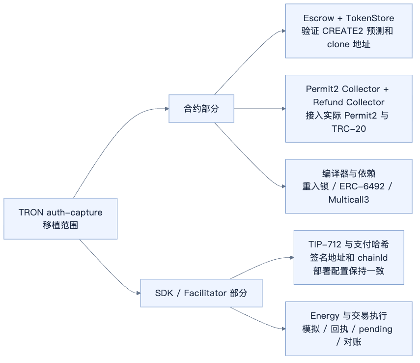

# TRON auth-capture 适配范围

> 未经评审的研究草稿。以下是移植范围与验证顺序，尚未完成编译、合约测试或链上部署验证。

更新：2026 年 10 月 20 日。[总目录](../README.md) · [分享主稿](auth-capture-contract-analysis.md) · [基础概念](auth-capture-foundations.md) · [合约源码](auth-capture-solidity-walkthrough.md) · [SDK 与接口](auth-capture-official-code-walkthrough.md)

## 1 首版范围

建议首版先做 **USDT + Permit2 + 单一 delegated operator**。沿用 Commerce Payments 的账本模型，移植必要的收付合约，再为 TRON SDK / facilitator 实现对应的签名、模拟、广播和对账。

TVM 兼容 Solidity，有助于复用代码，但不能据此认为现有 EVM 部署可供 TRON 直接调用，或只复制 AuthCaptureEscrow 就能完成接入。模型和角色见[基础概念](auth-capture-foundations.md)。



| 组件 | 首版处理 | 不能省略的依赖 |
| --- | --- | --- |
| AuthCaptureEscrow | 移植并部署六种操作及账本 | 重入锁、Collector 类型、入金核对 |
| TokenStore | 部署模板、按 operator 创建实例 | CREATE2 / clone 的预测与实际地址一致 |
| Permit2PaymentCollector | 从 payer 收款进入 TokenStore | 目标 Permit2 接口、签名域和 token allowance |
| OperatorRefundCollector | 从 operator 收取退款资金 | TRC-20 transferFrom、余额和给 Collector 的 allowance |
| TokenCollector 等基类 | 随具体合约编译适配 | 不额外部署一个抽象基类中转地址 |
| SDK / facilitator | 形成付款条件、签名、交易提交与状态恢复 | 原始 PaymentInfo、部署配置、持久化状态 |

## 2 为什么 USDT 首版不先做 3009 Collector

现有 TRON SDK 的[资产配置说明](https://github.com/BofAI/x402/blob/main/typescript/packages/mechanisms/tron/src/shared/defaultAssets.ts)为 USDT 选择 Permit2，因为它不支持所需的 3009 风格签名转账。Collector 只能使用代币已有的能力；写一个名为 TRC3009PaymentCollector 的合约，不会改变现有 USDT 的接口。

等目标代币确实支持相应签名收款，再增加 3009 路径。还要核对官方 ERC3009 Collector 的 receiveWithAuthorization，与现有 TRON exact 的 transferWithAuthorization 在接口、签名类型和调用约束上有哪些差别。

USDT 的预期流程是：

```text
首次准备：用户 approve USDT 给 Permit2
每笔支付：用户签名 → Escrow → PaymentCollector → Permit2
资金移动：payer → TokenStore
后续付款：Escrow → TokenStore → USDT.transfer → 商家 / 费用方
```

首次 allowance 和每笔付款签名是两个条件。还需与客户端一起验证钱包能否完成相应的结构化签名，以及失败或到期后怎样重试。

## 3 哪些现有组件可能复用

现有 SDK 的 [constants.ts](https://github.com/BofAI/x402/blob/main/typescript/packages/mechanisms/tron/src/constants.ts)登记了 TRON Permit2 和 exact / upto Proxy 地址，可作为接入线索。本文尚未核实这些地址的链上字节码和接口兼容性。

| 组件 | 复用前要确认什么 |
| --- | --- |
| Permit2 | 是否支持本方案需要的 permitTransferFrom，签名域、nonce 和地址处理是否匹配 |
| exact / upto Proxy | 使用 witness 支付流程，不能直接当成 auth-capture Collector；需核对订单绑定和资金去向 |
| token 工具和注册表 | TRC-20 ABI、decimals、地址表示和 allowance 查询是否适用 |
| 交易执行适配 | 模拟、Energy 估计、回执事件和 pending 处理是否覆盖生命周期 |

Permit2 / USDT 是通用依赖；PaymentCollector 负责把它们接到 auth-capture 订单和 TokenStore。

## 4 重点一：TokenStore 地址预测

资金可以先进入 TokenStore 的预测地址，实例等到首次支出时再部署。如果预测地址与实际部署地址不一致，后续就无法按预期转出资金。

TRON CREATE2 使用 0x41 推导前缀，EVM 使用 0xff。因此要逐项核对 LibClone 的创建代码、salt、部署地址和 TVM 推导规则，不能只修改 SDK 的地址格式。依据见 [TRON TVM 与 EVM 差异](https://developers.tron.network/docs/tvm-vs-evm)。

## 5 重点二：签名和 PaymentInfo 哈希

- 区分链上 20 字节地址与外部 Base58 / 41 前缀地址表示，保持编码一致。
- 合约与 SDK 必须使用同一 chainId、Escrow、字段顺序和 PaymentInfo 哈希规则。
- 账本哈希使用真实 payer，付款 nonce 使用 payer 置零后的条款哈希；不能拿 exact 的 witness 直接替换。
- Token 签名、Permit2 签名、商家操作签名各自使用正确的域、类型与签名表示。
- 后续 capture / refund 使用原条款和 saltNonce，不能重新生成期限或 salt 作为重试。

哈希及签名形成过程见[SDK 与接口走读](auth-capture-official-code-walkthrough.md#4-客户端签什么nonce-如何绑定条款)。

## 6 重点三：执行环境与恢复

原合约使用 Solidity ^0.8.28、Solady clone 和 transient storage 重入锁。需要根据目标 TRON 网络的实际升级配置，核对编译产物和 opcode，不能笼统认为 TVM 完全兼容或不支持 transient storage。参见[官方差异说明](https://developers.tron.network/docs/tvm-vs-evm)。

ERC-6492 / Multicall3 也要一起核对。首版如果限定钱包范围，SDK 就要明确支持哪些钱包，并拒绝尚未支持的签名路径，不能声称已兼容所有钱包。

facilitator 需要估计 Energy / 费用、构造并广播交易、等待回执、检查事件和余额，以及恢复 pending 交易。结果不明时，先核对原交易。refund 还需要资金协议、operator 余额和 allowance，开启配置不会自动解决这些问题。

## 7 建议验证顺序

1. 核对目标 Permit2 与 USDT 的实际接口、签名和 allowance。
2. 在目标 TVM 环境验证编译、CREATE2 预测、clone 和先入金后部署。
3. 跑通 authorize → capture → void / reclaim，核对六种操作的权限、期限与账本。
4. 跑通 charge 与部分退款，核对分账原子性、失败回滚和退款资金来源。
5. 接入 SDK 的支付条件、用户签名和商家授权，验证原始条款持久化。
6. 验证超时、重复请求、进程重启、回执不明、余额或 allowance 不足的恢复行为。

以上工作尚待执行，不代表测试已经通过。合约函数内部见[Solidity 走读](auth-capture-solidity-walkthrough.md)，请求组织与重试见[SDK 走读](auth-capture-official-code-walkthrough.md)。
